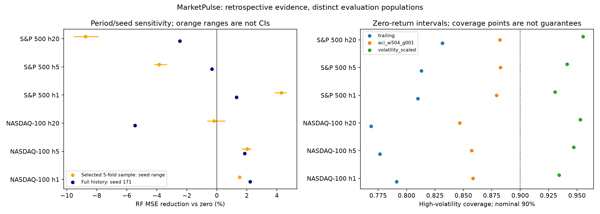

# Final MarketPulse research results

The saved evidence does not establish consistent superiority of complex ML over
simple return baselines. Some RF point estimates improve on the baselines, but
those gains do not survive the declared corrected comparisons. The evidence is
retrospective; independently unseen generalization remains unresolved.

## Evidence populations and research status

The historical study contains 282 folds, 355,320 model forecasts and
71,064 origin/horizon pairs [C01] [C02] [C27]. The canonical comparison is
zero return, historical mean, linear regression, RF and one LSTM family on two US
price indexes at horizons 1/5/20. These are price-return forecasts, not realized
trading strategies. Earlier course notebooks and terminal splits remain historical
or exploratory snapshots, not additional independent replications.

The Phase 9 independent-completion flag is `False` [C04]. Its frozen
prospective protocol is available, with 30 canonical model evaluations and
60 interval metric rows in the historical infrastructure rehearsal [C29]
[C28]. Baselines are procedures, so “model evaluations” must not be read as that
many independently fitted estimators. The older audit key `rehearsal_model_fits`
uses this evaluation count. Rehearsal scores are excluded from generalization claims.

Phase 10 adds 60 full-budget stochastic runs and 30,240 forecasts,
with 13.76 summed training minutes [C05] [C37] [C38]. Combined sensitivity
covers 30 selected folds and 1,260 chronological origins per cell
[C36] [C06], conditional on the fixed seeds [C07]. This is not a full-history
multi-seed replication. The selected cross-index seed sample has zero shared
endpoints [C30]; its cross-index comparison is unavailable. The separate historical
endpoint-matched population is retained [C11].

## Do complex models consistently improve point forecasts?

Native pooled winners below minimize concatenated-origin RMSE, not mean fold RMSE.
All scores, biases, MAE and directional accuracy remain in the consolidated point
table [C10]. Rankings describe a fixed retrospective sample, not forecast guarantees.

- NASDAQ-100, h1: random_forest has minimum RMSE 0.012787; RF MSE skill versus zero 0.0222; n=3,276 origins [C10].
- NASDAQ-100, h5: random_forest has minimum RMSE 0.026300; RF MSE skill versus zero 0.0185; n=3,276 origins [C10].
- NASDAQ-100, h20: zero_return has minimum RMSE 0.051814; RF MSE skill versus zero -0.0545; n=3,276 origins [C10].
- S&P 500, h1: random_forest has minimum RMSE 0.009885; RF MSE skill versus zero 0.0131; n=20,412 origins [C10].
- S&P 500, h5: historical_mean has minimum RMSE 0.022042; RF MSE skill versus zero -0.0033; n=20,412 origins [C10].
- S&P 500, h20: historical_mean has minimum RMSE 0.043674; RF MSE skill versus zero -0.0247; n=20,412 origins [C10].

The original LSTM pooled rank is 5 in every native cell [C24].
RF beats LSTM in 5 corrected original comparisons [C26], but **zero** RF
improvements over either simple baseline survive the original primary family
[C09]. Zero expanded ML improvements over those baselines survive its separate
family [C08] [C33]. Nonsignificance is not an equivalence result or proof that a
model can never help. The original RF S&P h20 comparisons show harm versus both
simple baselines: 2 corrected tests [C39] [C40]. Do not pool these
families, observations or p-values.

## What changes with population, horizon, regime and seed?

Matching actual origins AND endpoint dates changes the S&P h5 winner to linear
regression [C25], whereas its native winner is historical mean [C10]. Equal test
dates do not equalize training-history length, data conventions or index membership.
The expanded NASDAQ h20 LSTM seed ranks remain 1–5
[C12], despite its full-history last-place ranking. The complete seed ranges and
per-model point scores are preserved [C07]; selected-year outcomes do not overturn
full-history outcomes. Favorable seed selection is not evidence of consistency.

Volatility regimes use causal trailing volatility and training-only thresholds.
Conditional loss estimates retain the original timeline; separated regime days
are not compressed into adjacent observations. Short stress episodes remain
primarily descriptive. NASDAQ's forecast evaluation does not cover the earlier
dot-com or financial-crisis windows, while S&P's earlier series predates the modern
index. A crisis narrative must respect that unequal observation support.

## Are uncertainty estimates reliable?

The adaptive extension stores 1,421,280 method-origin records and independently
checks 2,780,000 eligible level/bound pairs [C13] [C14]. These repeat the same
underlying point forecasts; they are not additional independent market outcomes.
All methods use only strictly mature actual target endpoints. Coverage, width and
proper interval score for all methods/models and both nominal levels are in the
consolidated calibration table [C18].

The designated delayed adaptive variant has 20 Holm-adjusted proper-score
improvements [C15]: S&P horizons 1/5, all canonical point models and both levels
[C16]. These approximate retrospective tests compare it with trailing calibration,
not with the best possible method. No h20 or NASDAQ primary gain survives [C16]
[C35]. The longer-bandwidth sensitivity is exploratory, not another confirmation.
Volatility scaling can score better than the designated adaptive method [C17].

For zero-return S&P 500 h20 90% intervals, coverage changes from 0.885353 to 0.876663, while the interval score changes from 0.189678 to 0.187745 [C17]. A smaller proper score therefore need not mean closer nominal coverage.

For zero-return NASDAQ-100 h20 90% intervals, coverage changes from 0.884487 to 0.883489, while the interval score changes from 0.224022 to 0.214307 [C17]. A smaller proper score therefore need not mean closer nominal coverage.

The designated adaptive variant has 1,494/347,500 eligible
interval nesting violations [C19] [C20]. Faster adaptation has
26,355 (longer window) and 25,819 (shorter window); slower
short-window adaptation has 1,368 [C21] [C22] [C23]. Independently
adapted levels can cross; alpha clipping also changes the theoretical procedure.
These failures were retained, not repaired after observing outcomes. No finite
sample, arbitrary-dependence or conditional-regime coverage guarantee follows.

## Statistical interpretation and limitations

Paired moving blocks preserve actual session continuity and target endpoints.
Bartlett HAC and Holm use the declared families; bootstrap intervals are marginal,
not simultaneous. Inference approximates historical average effects under weak
dependence; structural shifts, long-memory dependence and overlapping targets can
undermine that approximation. Block-length sensitivity is not an estimate of the
true effective sample size. Fixed-seed loss averaging conditions on those optimizer
realizations and does not create more temporal observations or evaluate an ensemble.

All quantitative comparisons are retrospective or sensitivity analyses. A protocol
frozen before new execution does not erase earlier model/method exposure. No
confirmatory outcomes exist [C04]. NASDAQ and S&P are correlated US indexes with
unequal training histories, overlapping coverage and changing construction; these
are not independent samples of all financial markets. Raw acquisition timestamps,
precise source versions and licensing remain incomplete. Price closes are not
dividend-adjusted total returns. The 210 recovered original folds still lack
original execution revisions/environments [C03]; independent audits do not repair
that missing history. Local numerical reruns are not cross-platform or weight-level
reproducibility. Transaction costs, turnover, investable execution and economic
utility were not tested. Other architectures, markets and feature families remain
outside this canonical comparison.

## Evidence and manuscript readiness

Consolidated CSVs are `point_comparisons.csv`, `seed_comparisons.csv`,
`calibration_comparisons.csv` and `statistical_summary.csv` under `results/phase12`.
They retain source-claim IDs and distinct populations/loss units. The executable
registry `claims.json` pins source SHA256, selectors, operations and expected values.
Every measured conclusion above cites its registry IDs. The synthesis audit checks
all claims and report hashes. Earlier independent arithmetic audits remain the
basis for scientific calculations, not merely this traceability layer.

All 6 cross-phase audits pass and historical trees remain unchanged
[C31] [C32]. The study is ready for a carefully qualified retrospective empirical
manuscript. Independent chronological confirmation is a required future experiment
for claims of unseen generalization; it is not required to honestly report these
negative/inconclusive comparisons and calibration failure cases. Phase 13 may
proceed with those limits, without claims of profitable trading, universal ML
inferiority, theoretical coverage guarantees or independently validated adaptive gains.

Reproduce with `python scripts/final_synthesis.py verify`; run the individual saved
study audits listed in `results/phase12/audits/manifest.json`. A fresh comprehensive
logged audit uses `python scripts/audit_all_research.py` in a new unpopulated output
state. Existing logs are preserved. Future intake is described in
`docs/PROSPECTIVE_INTAKE.md`; its unavailable observations are not synthesized here.
