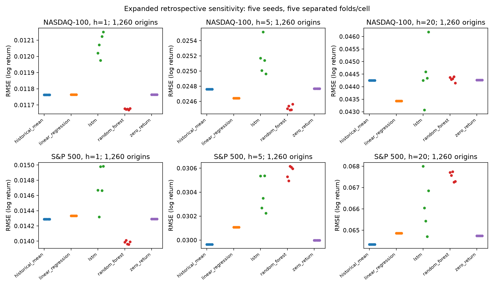
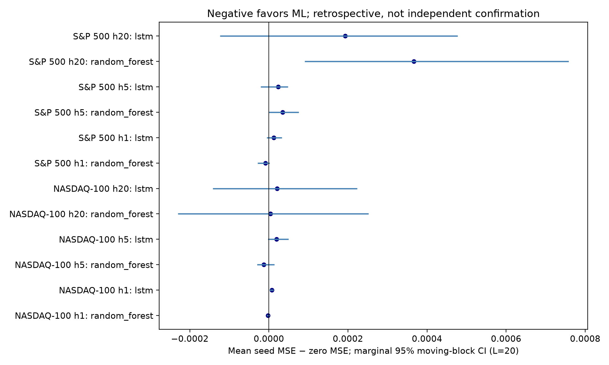

# Phase 10 — Expanded temporal and seed robustness

## Acceptance and predeclared expansion

Preserve the original 282 folds and all 90 Phase 6 stochastic run artifacts.
Add exactly 60 full-budget runs: five seeds × 12 intervening index/horizon folds.
Retain both RF depth candidates, both LSTM hidden-size candidates, 200 trees,
25 maximum epochs, patience five and all original sample lengths. No shortened
training substitutes. The existing 18-fold sample showed NASDAQ h20 LSTM ranks
1–5 and opposite RF behavior at short NASDAQ versus long S&P horizons. Additional
seeds alone cannot address that temporal sensitivity.

`configs/phase10.json` fixes added fold quantiles .25/.75, seeds 171/271/371/471/571,
pairs, loss aggregation, bootstrap parameters and multiplicity before new runs.
Combined coverage becomes five folds/cell (30 folds), not a five-seed replication
of all 282. Each new run trains both stochastic models at the original budget.
Old deterministic forecasts and previous stochastic runs are reused byte-for-byte.
Cost estimate: 15–25 minutes based on the original 90-run, 21-minute study;
actual timings are recorded per task, never inferred from the estimate.

Acceptance requires identical origin/endpoint/actual vectors across models/seeds,
independent metric and HAC audits, all 60 task checksums, no cross-gap bootstrap
blocks, full settings/environment/revision records and passing regression checks.

## Statistical estimand

Average the five **losses** at each origin, not the five predictions. This estimates
sensitivity averaged over the fixed seeds; it is not an ensemble evaluation and
five seeds do not multiply the temporal sample size. Thirty primary overall MSE
comparisons (five pairs × six cells) use block length 20 and Holm correction.
Lengths 40/80 and volatility-conditional analyses are exploratory. Bootstrap CIs
are marginal 95%, 2,000 replicates. Bartlett HAC approximations retain chronological
session positions. Blocks never cross the separated selected-year gaps. Small
regime samples remain descriptive when fewer than ten nominal block equivalents.

Models within each index/horizon use exactly the same origins and actual target
endpoints. Different indexes' selected folds have different calendars and training
histories: do not interpret their pooled seed results as a common-calendar contest.
The separately saved full-history endpoint-matched Phase 6 comparison remains the
appropriate cross-index descriptive control. Calendar selection is retrospective
and covers only five separated years per cell; neither Holm nor more seeds repairs
historical researcher selection or creates independent market replications.

## Executed findings

All 60 new full-budget tasks completed in 13.76 summed training minutes: 120 stochastic model-fold evaluations and 30,240 new predictions. Combined coverage is 150 tasks on 30 distinct folds, five seeds and 1,260 temporal origins per cell. Deterministic forecasts are reused.

- NASDAQ-100 h1, random_forest: RMSE 0.011669–0.011678, zero-baseline skill 0.0144–0.0161, ranks 1–1.
- NASDAQ-100 h1, lstm: RMSE 0.011975–0.012151, zero-baseline skill -0.0668–-0.0363, ranks 5–5.
- NASDAQ-100 h5, random_forest: RMSE 0.024486–0.024563, zero-baseline skill 0.0165–0.0227, ranks 1–1.
- NASDAQ-100 h5, lstm: RMSE 0.024964–0.025514, zero-baseline skill -0.0611–-0.0158, ranks 5–5.
- NASDAQ-100 h20, random_forest: RMSE 0.044147–0.044398, zero-baseline skill -0.0061–0.0052, ranks 2–5.
- NASDAQ-100 h20, lstm: RMSE 0.043069–0.046180, zero-baseline skill -0.0885–0.0532, ranks 1–5.
- S&P 500 h1, random_forest: RMSE 0.013958–0.014012, zero-baseline skill 0.0387–0.0462, ranks 1–1.
- S&P 500 h1, lstm: RMSE 0.014319–0.014983, zero-baseline skill -0.0990–-0.0038, ranks 4–5.
- S&P 500 h5, random_forest: RMSE 0.030495–0.030615, zero-baseline skill -0.0416–-0.0334, ranks 4–5.
- S&P 500 h5, lstm: RMSE 0.030225–0.030536, zero-baseline skill -0.0363–-0.0152, ranks 4–5.
- S&P 500 h20, random_forest: RMSE 0.067252–0.067746, zero-baseline skill -0.0950–-0.0791, ranks 4–5.
- S&P 500 h20, lstm: RMSE 0.064705–0.067994, zero-baseline skill -0.1030–0.0011, ranks 2–5.

Primary effects use seed-averaged MSE and 1,260 observations, not 6,300 seed rows. All 30 results, marginal CIs, HAC p-values and Holm values are below. Regime and individual-fold results are exploratory.

- NASDAQ-100 h1: random_forest vs zero_return: ΔMSE -2.096768e-06, CI [-3.456816e-06, 6.802642e-07], Holm p=1.
- NASDAQ-100 h1: random_forest vs historical_mean: ΔMSE -2.075277e-06, CI [-3.467007e-06, 6.981562e-07], Holm p=1.
- NASDAQ-100 h1: lstm vs zero_return: ΔMSE 7.26089e-06, CI [3.54605e-06, 1.016018e-05], Holm p=0.0010712.
- NASDAQ-100 h1: lstm vs historical_mean: ΔMSE 7.282381e-06, CI [3.5798e-06, 1.017159e-05], Holm p=0.0010114.
- NASDAQ-100 h1: random_forest vs lstm: ΔMSE -9.357658e-06, CI [-1.222724e-05, -4.015063e-06], Holm p=0.0095202.
- NASDAQ-100 h5: random_forest vs zero_return: ΔMSE -1.243927e-05, CI [-2.836803e-05, 1.247857e-05], Holm p=1.
- NASDAQ-100 h5: random_forest vs historical_mean: ΔMSE -1.208194e-05, CI [-2.781435e-05, 1.350707e-05], Holm p=1.
- NASDAQ-100 h5: lstm vs zero_return: ΔMSE 1.95324e-05, CI [-6.306604e-07, 4.815975e-05], Holm p=1.
- NASDAQ-100 h5: lstm vs historical_mean: ΔMSE 1.988973e-05, CI [6.894847e-08, 4.944435e-05], Holm p=1.
- NASDAQ-100 h5: random_forest vs lstm: ΔMSE -3.197167e-05, CI [-5.474297e-05, -9.350771e-06], Holm p=0.14076.
- NASDAQ-100 h20: random_forest vs zero_return: ΔMSE 3.721129e-06, CI [-0.0002282617, 0.0002504195], Holm p=1.
- NASDAQ-100 h20: random_forest vs historical_mean: ΔMSE 4.786997e-06, CI [-0.000240367, 0.0002677416], Holm p=1.
- NASDAQ-100 h20: lstm vs zero_return: ΔMSE 2.086538e-05, CI [-0.0001405203, 0.0002216689], Holm p=1.
- NASDAQ-100 h20: lstm vs historical_mean: ΔMSE 2.193125e-05, CI [-0.0001489279, 0.0002369761], Holm p=1.
- NASDAQ-100 h20: random_forest vs lstm: ΔMSE -1.714425e-05, CI [-0.000227107, 0.0001959694], Holm p=1.
- S&P 500 h1: random_forest vs zero_return: ΔMSE -8.759474e-06, CI [-2.659742e-05, 2.958398e-07], Holm p=1.
- S&P 500 h1: random_forest vs historical_mean: ΔMSE -8.661973e-06, CI [-2.671964e-05, 3.98318e-07], Holm p=1.
- S&P 500 h1: lstm vs zero_return: ΔMSE 1.256465e-05, CI [-3.798487e-06, 3.155417e-05], Holm p=1.
- S&P 500 h1: lstm vs historical_mean: ΔMSE 1.266215e-05, CI [-3.87279e-06, 3.177662e-05], Holm p=1.
- S&P 500 h1: random_forest vs lstm: ΔMSE -2.132413e-05, CI [-4.456207e-05, -6.014999e-06], Holm p=0.84943.
- S&P 500 h5: random_forest vs zero_return: ΔMSE 3.459396e-05, CI [8.265051e-07, 7.386301e-05], Holm p=1.
- S&P 500 h5: random_forest vs historical_mean: ΔMSE 3.658462e-05, CI [4.435782e-06, 7.739322e-05], Holm p=1.
- S&P 500 h5: lstm vs zero_return: ΔMSE 2.328595e-05, CI [-1.941383e-05, 4.682733e-05], Holm p=1.
- S&P 500 h5: lstm vs historical_mean: ΔMSE 2.527661e-05, CI [-1.538127e-05, 4.964872e-05], Holm p=1.
- S&P 500 h5: random_forest vs lstm: ΔMSE 1.130801e-05, CI [-2.117876e-05, 6.320949e-05], Holm p=1.
- S&P 500 h20: random_forest vs zero_return: ΔMSE 0.0003668683, CI [9.251811e-05, 0.0007568696], Holm p=0.66391.
- S&P 500 h20: random_forest vs historical_mean: ΔMSE 0.0004189699, CI [0.0001326849, 0.0008725315], Holm p=0.58278.
- S&P 500 h20: lstm vs zero_return: ΔMSE 0.0001930769, CI [-0.0001223116, 0.000475827], Holm p=1.
- S&P 500 h20: lstm vs historical_mean: ΔMSE 0.0002451785, CI [-1.617958e-05, 0.0005167481], Holm p=1.
- S&P 500 h20: random_forest vs lstm: ΔMSE 0.0001737914, CI [-0.0001954455, 0.0007623752], Holm p=1.

## Interpretation and reproduction

The original 282-fold inference remains separate. Expanding this subset does not
revise its sample size or eliminate selection bias. Rank reversals across these
populations show period sensitivity, not a reason to retune. Loss averaging
conditions on five fixed seeds, not all possible optimizer realizations. Regime
estimates retain the full timeline; their selected days are not independent.
Training histories, index construction and source quality remain unequal.
`common_calendar_metrics.csv` additionally restricts the expanded sample to the
intersection of both indexes' origins AND actual target endpoints. There are zero
shared origins/endpoints in this five-fold-per-cell selection
(as recorded in `common_calendar_counts.csv`), so that metric file is header-only:
no cross-index matched seed comparison is available. The earlier full-history
matched analysis remains available and does not equalize training history.

Run `python scripts/phase10.py train` (checksum-checked resume),
`python scripts/phase10.py analyze` (unsealed output only), and
`python scripts/phase10.py verify`. Seed-171 reruns check 24 newly selected
model/fold pairs against original predictions. Earlier evidence is immutable.

## Reconciliation and execution audit

No ML improvement over zero or historical mean survives Holm in this 30-test
family. The three adjusted p<.05 comparisons are NASDAQ h1 LSTM **worse** than
zero and mean, and RF better than LSTM. Statistical evidence for RF over LSTM
is not evidence for RF over simple baselines. NASDAQ h20 LSTM still spans ranks
1–5; RF now spans 2–5 versus 2–3 on the earlier subset. S&P h20 LSTM spans 2–5
versus 4–5 earlier. These changes support period/seed sensitivity, not general
superiority. The earlier full-history negative/inconclusive baseline findings
remain intact; its 18-test family must not be pooled with this selected family.

The first plotting attempt aborted in the macOS GUI backend. A headless backend
fixed rendering; a subsequent report-writer name collision was also corrected.
Both error logs and attempt manifests are retained. Every numeric CSV and loss
panel from the first attempt remained byte-identical after those engineering
fixes (hashes in `first_attempt_metric_hashes.json`); no model was rerun or tuned.
The independent audit recomputes 150 pooled scores, all fold/regime RMSE/ranks,
330 paired point/HAC results, 30 primary explicit-block bootstrap CIs and Holm
correction, acquisition targets and all settings/boundaries. Figure layouts were
visually inspected. `requirements.txt` and each run's revision/timing/environment
complete the new execution record; missing original legacy metadata remains missing.
