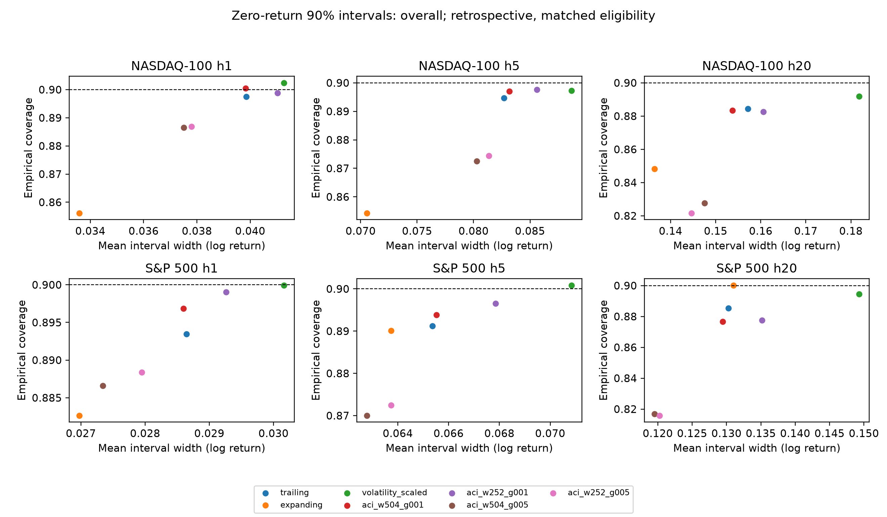
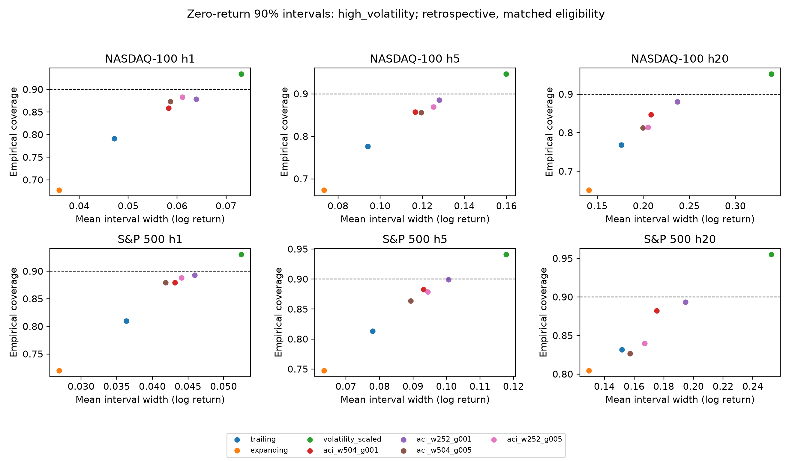

# Phase 11 — Delayed adaptive forecast uncertainty

## Acceptance and frozen design

Use the original saved out-of-sample point forecasts without refitting or selecting
new models. Materialize every interval and adaptation state for all five models,
two indexes, horizons 1/5/20 and nominal levels 80/90%. Require actual endpoint
maturity for both calibration residuals and coverage feedback; independently audit
every bound and feedback update. Compare the same eligible origins and retain
all four fixed variants, including failures. `configs/phase11.json` is frozen
before evaluation. Estimated cost is several CPU minutes for calibration/auditing,
with no neural retraining and no reduced training-budget substitution.

## Method and relationship to prior work

[Gibbs and Candès (2021)](https://arxiv.org/abs/2106.00170v3) motivate adapting a
miscoverage parameter using realized coverage errors. This implementation is a
**bounded, delayed-feedback ACI-inspired variant**, not an implementation of their
coverage theorem. At an origin, process earlier predictions in chronological
endpoint order only when `target_date < origin`. A mature, previously eligible
interval contributes its own miss indicator; warmup forecasts provide residuals
but no fictitious interval feedback. Update each level's state by
`alpha <- clip(alpha + gamma * (target_miscoverage - past_miss), .02, .5)`.
Then take rank `ceil((n+1)*(1-alpha))` of the latest mature absolute residuals.
The finite bounds follow from the declared alpha bounds and minimum history 252;
clipping events are recorded. Interval scores always use the fixed nominal level,
not the changing internal alpha. Point models and the interval center do not change.

The factorial sensitivity is windows 252/504 × gamma .01/.05, minimum 252. The
reference is existing trailing-504; expanding and volatility-scaled methods are
included in coverage/width/score comparisons. The designated primary sensitivity
variant is w504/gamma .01, not the best retrospective performer. Its 60 overall
interval-score comparisons versus trailing (30 point-model cells × two levels)
form one Holm family at L20. L40/L80 and other variants are exploratory. Coverage
bootstrap intervals are marginal diagnostics, not simultaneous coverage tests.
Session-preserving moving blocks and Bartlett HAC use the existing audited methods.

[Barber et al.](https://arxiv.org/abs/2202.13415v5) discuss conformal inference when
exchangeability fails; their guarantees must not be transferred to this different
procedure. Delayed, overlapping financial targets, bounded adaptation, repeatedly
refitted point models and market shifts prevent an arbitrary distribution-free,
finite-sample or conditional-regime guarantee here. Earlier OOS outcomes can enter
later point-model training. This is prequential retrospective procedure calibration,
not split conformal calibration of one permanently fixed fitted model.

## Reproduction and independent validation

`python scripts/phase11.py run` creates a fresh, immutable result bundle under
`results/phase11`. `python scripts/phase11.py verify` independently reconstructs
mature populations using endpoint searches, quantiles using a count tree rather
than sorted lists, feedback using saved past bounds, and metrics using separate
arithmetic. Tests cover irregular sessions, future-outcome perturbations, equal-date
exclusion, clipped states, invalid endpoints and the zero-adaptation reference.
Compressed records omit duplicated outcomes/predictions/regimes: join their unique
dates to the SHA256-pinned original point forecasts. This is a compact lossless
evidence representation, not a change in evaluation population.

## Executed findings

Generation/comparisons took 69.82 seconds before independent auditing; 1,421,280 saved records in 120 files.

- NASDAQ-100 h1 trailing: coverage 0.8975, width 0.03985, proper score 0.06002, n=3023.
- NASDAQ-100 h1 expanding: coverage 0.8561, width 0.03359, proper score 0.06145, n=3023.
- NASDAQ-100 h1 volatility_scaled: coverage 0.9024, width 0.04127, proper score 0.05392, n=3023.
- NASDAQ-100 h5 trailing: coverage 0.8947, width 0.08268, proper score 0.12023, n=3019.
- NASDAQ-100 h5 expanding: coverage 0.8543, width 0.07056, proper score 0.12271, n=3019.
- NASDAQ-100 h5 volatility_scaled: coverage 0.8973, width 0.08867, proper score 0.11160, n=3019.
- NASDAQ-100 h20 trailing: coverage 0.8845, width 0.15712, proper score 0.22402, n=3004.
- NASDAQ-100 h20 expanding: coverage 0.8482, width 0.13644, proper score 0.22642, n=3004.
- NASDAQ-100 h20 volatility_scaled: coverage 0.8918, width 0.18181, proper score 0.22466, n=3004.
- S&P 500 h1 trailing: coverage 0.8934, width 0.02864, proper score 0.04346, n=20159.
- S&P 500 h1 expanding: coverage 0.8826, width 0.02698, proper score 0.04523, n=20159.
- S&P 500 h1 volatility_scaled: coverage 0.8999, width 0.03016, proper score 0.03990, n=20159.
- S&P 500 h5 trailing: coverage 0.8912, width 0.06537, proper score 0.09463, n=20155.
- S&P 500 h5 expanding: coverage 0.8901, width 0.06374, proper score 0.09686, n=20155.
- S&P 500 h5 volatility_scaled: coverage 0.9009, width 0.07084, proper score 0.09084, n=20155.
- S&P 500 h20 trailing: coverage 0.8854, width 0.13029, proper score 0.18968, n=20140.
- S&P 500 h20 expanding: coverage 0.9002, width 0.13099, proper score 0.18909, n=20140.
- S&P 500 h20 volatility_scaled: coverage 0.8945, width 0.14930, proper score 0.19260, n=20140.
- NASDAQ-100 h1 aci_w504_g001: coverage 0.9004, width 0.03983, proper score 0.05710, n=3023.
- NASDAQ-100 h1 aci_w252_g001: coverage 0.8988, width 0.04102, proper score 0.05789, n=3023.
- NASDAQ-100 h1 aci_w504_g005: coverage 0.8865, width 0.03751, proper score 0.05437, n=3023.
- NASDAQ-100 h1 aci_w252_g005: coverage 0.8869, width 0.03780, proper score 0.05395, n=3023.
- NASDAQ-100 h5 aci_w504_g001: coverage 0.8970, width 0.08316, proper score 0.11574, n=3019.
- NASDAQ-100 h5 aci_w252_g001: coverage 0.8976, width 0.08560, proper score 0.11767, n=3019.
- NASDAQ-100 h5 aci_w504_g005: coverage 0.8725, width 0.08029, proper score 0.11371, n=3019.
- NASDAQ-100 h5 aci_w252_g005: coverage 0.8745, width 0.08135, proper score 0.11330, n=3019.
- NASDAQ-100 h20 aci_w504_g001: coverage 0.8835, width 0.15370, proper score 0.21431, n=3004.
- NASDAQ-100 h20 aci_w252_g001: coverage 0.8825, width 0.16057, proper score 0.22001, n=3004.
- NASDAQ-100 h20 aci_w504_g005: coverage 0.8276, width 0.14751, proper score 0.23267, n=3004.
- NASDAQ-100 h20 aci_w252_g005: coverage 0.8216, width 0.14463, proper score 0.23584, n=3004.
- S&P 500 h1 aci_w504_g001: coverage 0.8969, width 0.02860, proper score 0.04073, n=20159.
- S&P 500 h1 aci_w252_g001: coverage 0.8991, width 0.02926, proper score 0.04102, n=20159.
- S&P 500 h1 aci_w504_g005: coverage 0.8866, width 0.02734, proper score 0.03994, n=20159.
- S&P 500 h1 aci_w252_g005: coverage 0.8884, width 0.02795, proper score 0.03989, n=20159.
- S&P 500 h5 aci_w504_g001: coverage 0.8938, width 0.06552, proper score 0.08995, n=20155.
- S&P 500 h5 aci_w252_g001: coverage 0.8965, width 0.06785, proper score 0.09143, n=20155.
- S&P 500 h5 aci_w504_g005: coverage 0.8700, width 0.06279, proper score 0.09105, n=20155.
- S&P 500 h5 aci_w252_g005: coverage 0.8725, width 0.06373, proper score 0.09121, n=20155.
- S&P 500 h20 aci_w504_g001: coverage 0.8767, width 0.12946, proper score 0.18775, n=20140.
- S&P 500 h20 aci_w252_g001: coverage 0.8776, width 0.13516, proper score 0.19336, n=20140.
- S&P 500 h20 aci_w504_g005: coverage 0.8168, width 0.11953, proper score 0.20357, n=20140.
- S&P 500 h20 aci_w252_g005: coverage 0.8158, width 0.12025, proper score 0.20348, n=20140.

All models, levels, regimes and stress slices are in `all_methods_metrics.csv`;
unavailable stress episodes retain n=0. Marginal bootstrap coverage CIs are in
`coverage_uncertainty.csv`. Proper-score effects, marginal CIs and the fixed
60-test Holm family are in `score_comparisons.csv`. No method is independently
validated.

## Statistical interpretation and failures

The designated w504/gamma .01 variant has Holm-adjusted proper-score improvements
in 20/60 primary comparisons: every S&P 500 model at horizons 1 and 5, both levels.
None of the NASDAQ comparisons or h20 comparisons survives correction; no primary
harm survives either. These are retrospective approximate HAC tests within one
fixed family, not independent confirmation or superiority over volatility scaling.
The marginal bootstrap CIs and dependence-length sensitivities remain available;
Holm-adjusted p-values do not make those CIs simultaneous.

For zero-return 90% intervals, S&P h1 score changes from .043455 (trailing) to
.040732 (designated adaptive), while volatility scaling scores .039895. S&P h20
adaptive coverage is .876663 versus .885353 trailing, despite a slightly lower
score (.187745 versus .189678). Thus a proper-score improvement does not imply
closer nominal coverage. NASDAQ h20 high-volatility coverage rises from .768778 to
.846834 but remains below .90; volatility scaling covers .952872 with much wider
intervals (.338787 versus adaptive .208477). No single setting solves all cells.

Independent alpha states can produce nonnested nominal levels. The post-execution
failure diagnostic counts 1,494/347,500 eligible method-origin pairs with crossings
for the designated variant; faster gamma .05 gives 26,355/347,500 (w504) and
25,819/347,500 (w252). The slower w252 variant has 1,368/347,500. These counts
are sensitivity outputs, not independent samples. No interval hull, alpha projection
or retuning was applied after inspection. Bounded alpha saturation is also recorded
by model/variant in `diagnostics.csv`. Delayed feedback, finite windows, abrupt
volatility shifts, clipping and independently adapted levels are material failures
of these experimental variants. A future nesting constraint would be a different
method requiring a separately frozen evaluation.

`python scripts/phase11_diagnostics.py --verify` recomputes all 120 diagnostic rows.
The main audit verifies every bound/state, 1,680 metric rows, 360 proper-score
comparison rows, all 240 coverage CIs, 60 primary score CIs via independent block
arithmetic, and Holm correction. Original fixed methods and forecasts are unchanged.
Figures were visually inspected. All apparent gains remain retrospective and carry
no arbitrary-dependence distribution-free guarantee.
