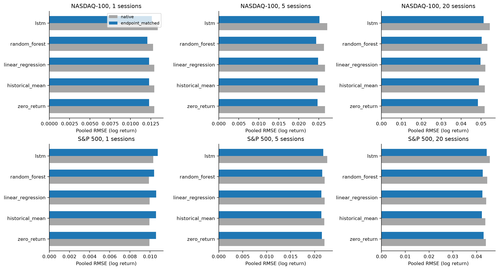
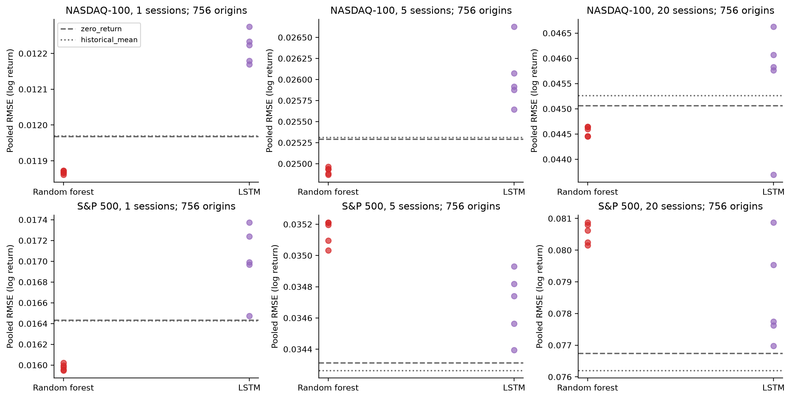
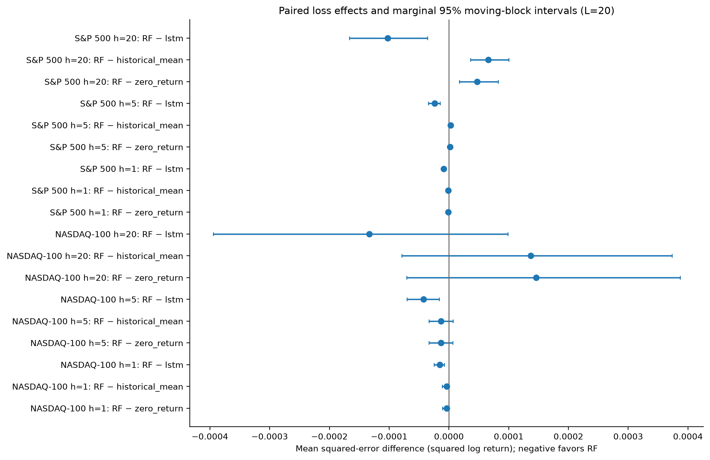
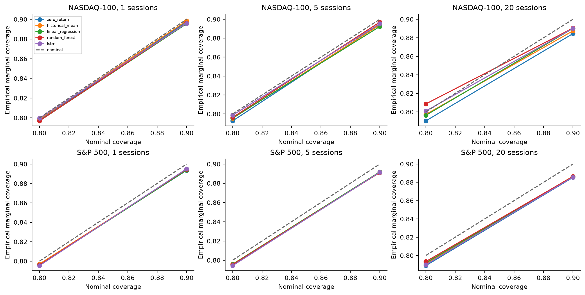
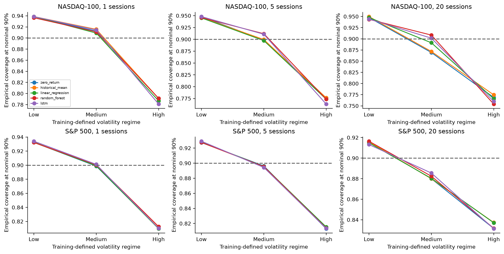
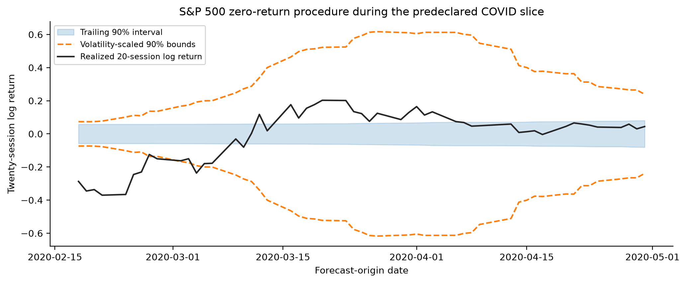

# Robustness, statistical reliability, and forecast uncertainty

## Executed scope

The Phase 4/5 baseline was independently re-audited: 282 folds, 355,320 predictions, actual label endpoints, split/selection metadata, original hashes and recomputed errors. Its 210 missing legacy execution records remain missing. New inference and intervals reuse these forecasts; they do not establish the original training provenance.

The fixed five-seed experiment retrains RF and LSTM on the earliest, middle, and latest folds in each index/horizon cell: 18 folds × 5 seeds = 90 full-budget tasks / 180 stochastic model-fold evaluations. Each seed covers 756 origins per cell. This is a balanced sensitivity subset, not a five-seed replication of all 282 folds. Deterministic forecasts are reused. All alternatives and seeds were declared in `configs/robustness.toml` and committed before execution.

## Matched calendars

Primary matching requires both origin and actual target endpoint dates; origin-only matching is a fixed sensitivity. They coincide on these saved files (zero endpoint disagreements). Each index/horizon retains 2,232 origins: 68.13% of NASDAQ's 3,276 and 10.93% of S&P's 20,412. This equalizes evaluation dates, not training histories or annual fold boundaries. Results are not independent markets or index transfer evidence.

| dataset | horizon | population | n | removed |
| --- | --- | --- | --- | --- |
| NASDAQ-100 | 1 | native | 3276 | 0 |
| NASDAQ-100 | 20 | native | 3276 | 0 |
| NASDAQ-100 | 5 | native | 3276 | 0 |
| S&P 500 | 1 | native | 20412 | 0 |
| S&P 500 | 20 | native | 20412 | 0 |
| S&P 500 | 5 | native | 20412 | 0 |
| NASDAQ-100 | 1 | endpoint_matched | 2232 | 1044 |
| NASDAQ-100 | 20 | endpoint_matched | 2232 | 1044 |
| NASDAQ-100 | 5 | endpoint_matched | 2232 | 1044 |
| S&P 500 | 1 | endpoint_matched | 2232 | 18180 |
| S&P 500 | 20 | endpoint_matched | 2232 | 18180 |
| S&P 500 | 5 | endpoint_matched | 2232 | 18180 |

Pooled RMSE winners (descriptive, selected from each reported population):

| dataset | horizon | population | model | rmse | skill_vs_zero |
| --- | --- | --- | --- | --- | --- |
| NASDAQ-100 | 1 | endpoint_matched | random_forest | 0.012082 | 0.0345711 |
| NASDAQ-100 | 1 | native | random_forest | 0.0127868 | 0.0221926 |
| NASDAQ-100 | 5 | endpoint_matched | random_forest | 0.0243581 | 0.0271581 |
| NASDAQ-100 | 5 | native | random_forest | 0.0262997 | 0.0184945 |
| NASDAQ-100 | 20 | endpoint_matched | zero_return | 0.0484585 | 0 |
| NASDAQ-100 | 20 | native | zero_return | 0.0518138 | 0 |
| S&P 500 | 1 | endpoint_matched | random_forest | 0.0104023 | 0.0366726 |
| S&P 500 | 1 | native | random_forest | 0.00988535 | 0.0130578 |
| S&P 500 | 5 | endpoint_matched | linear_regression | 0.0214135 | 0.0101001 |
| S&P 500 | 5 | native | historical_mean | 0.0220424 | 0.0022648 |
| S&P 500 | 20 | endpoint_matched | historical_mean | 0.0422051 | 0.0321676 |
| S&P 500 | 20 | native | historical_mean | 0.0436735 | 0.00943531 |

All models' MAE/RMSE, both baseline skills and ranks are in `results/robustness/matched/metrics.csv`; membership records retain endpoint dates.

## Optimization-seed sensitivity

Ranges below summarize five seeds over the same three folds, not confidence intervals over independent market histories. Rank is among all five forecasts.

| dataset | horizon | model | rmse_min | rmse_max | skill_min | skill_max | rank_min | rank_max |
| --- | --- | --- | --- | --- | --- | --- | --- | --- |
| NASDAQ-100 | 1 | lstm | 0.0121691 | 0.012275 | -0.0519949 | -0.0339337 | 5 | 5 |
| NASDAQ-100 | 1 | random_forest | 0.0118611 | 0.011873 | 0.0157739 | 0.0177438 | 1 | 1 |
| NASDAQ-100 | 5 | lstm | 0.025643 | 0.0266279 | -0.108468 | -0.0279777 | 5 | 5 |
| NASDAQ-100 | 5 | random_forest | 0.0248693 | 0.0249633 | 0.0257955 | 0.0331142 | 1 | 1 |
| NASDAQ-100 | 20 | lstm | 0.0436937 | 0.0466291 | -0.0707558 | 0.0598162 | 1 | 5 |
| NASDAQ-100 | 20 | random_forest | 0.0444531 | 0.0446452 | 0.0184197 | 0.0268513 | 2 | 3 |
| S&P 500 | 1 | lstm | 0.0164723 | 0.0173747 | -0.117767 | -0.00467324 | 4 | 5 |
| S&P 500 | 1 | random_forest | 0.0159477 | 0.0160232 | 0.0493596 | 0.0582977 | 1 | 1 |
| S&P 500 | 5 | lstm | 0.0343936 | 0.0349306 | -0.0362842 | -0.00466111 | 3 | 4 |
| S&P 500 | 5 | random_forest | 0.0350324 | 0.035212 | -0.053048 | -0.0423319 | 5 | 5 |
| S&P 500 | 20 | lstm | 0.0769741 | 0.0808763 | -0.110568 | -0.00598586 | 4 | 5 |
| S&P 500 | 20 | random_forest | 0.0801483 | 0.080875 | -0.110532 | -0.090665 | 4 | 5 |

On the selected NASDAQ twenty-session folds, LSTM spans ranks 1–5 and skill versus zero -0.0708 to +0.0598. This is a material optimization-sensitivity result, not evidence that the full-history LSTM ranking reverses. The selected S&P five-session subset also ranks RF last across seeds, unlike its full-history pooled rank. Subset history and optimization variability must be kept distinct.

Fresh seed-171 predictions agree numerically at rtol=1e-10/atol=1e-12 with the old forecasts in 36/36 selected model-fold comparisons. Maximum absolute prediction difference: 0. Agreement strengthens targeted numerical reproducibility; it does not reconstruct the old execution context or establish full historical replication.

## Paired statistical comparisons

Primary follow-ups use squared-error loss, native calendars, Bartlett HAC bandwidth 19, and one Holm family of 18 two-sided tests. Negative effects favor RF. The displayed CIs are marginal 95% moving-block percentile intervals (2,000 replicates, L=20), not simultaneous Holm-adjusted intervals. These same-history, retrospective comparisons rely on weak-dependence approximations and cannot supply independent confirmation.

| dataset | horizon | second | mean_loss_difference | ci_lower | ci_upper | holm_p_value |
| --- | --- | --- | --- | --- | --- | --- |
| NASDAQ-100 | 1 | zero_return | -3.71089e-06 | -1.09284e-05 | 2.56302e-07 | 1 |
| NASDAQ-100 | 1 | historical_mean | -3.72196e-06 | -1.09851e-05 | 2.62688e-07 | 1 |
| NASDAQ-100 | 1 | lstm | -1.51551e-05 | -2.48196e-05 | -7.91064e-06 | 0.0057043 |
| NASDAQ-100 | 5 | zero_return | -1.30333e-05 | -3.34665e-05 | 6.4432e-06 | 1 |
| NASDAQ-100 | 5 | historical_mean | -1.31776e-05 | -3.36375e-05 | 6.94856e-06 | 1 |
| NASDAQ-100 | 5 | lstm | -4.26456e-05 | -7.03916e-05 | -1.6367e-05 | 0.022489 |
| NASDAQ-100 | 20 | zero_return | 0.000146262 | -7.07139e-05 | 0.000386806 | 1 |
| NASDAQ-100 | 20 | historical_mean | 0.000137123 | -7.88887e-05 | 0.000373453 | 1 |
| NASDAQ-100 | 20 | lstm | -0.00013311 | -0.000394469 | 9.87315e-05 | 1 |
| S&P 500 | 1 | zero_return | -1.29289e-06 | -2.57461e-06 | -3.34252e-07 | 0.311017 |
| S&P 500 | 1 | historical_mean | -1.24731e-06 | -2.57234e-06 | -2.83396e-07 | 0.35806 |
| S&P 500 | 1 | lstm | -8.91055e-06 | -1.19766e-05 | -6.2088e-06 | 7.17806e-08 |
| S&P 500 | 5 | zero_return | 1.62537e-06 | -2.27571e-06 | 4.80391e-06 | 1 |
| S&P 500 | 5 | historical_mean | 2.72826e-06 | -1.04412e-06 | 5.96745e-06 | 1 |
| S&P 500 | 5 | lstm | -2.39941e-05 | -3.43478e-05 | -1.49577e-05 | 2.89785e-05 |
| S&P 500 | 20 | zero_return | 4.74848e-05 | 1.74392e-05 | 8.25642e-05 | 0.0444672 |
| S&P 500 | 20 | historical_mean | 6.56529e-05 | 3.63981e-05 | 9.99927e-05 | 0.000942656 |
| S&P 500 | 20 | lstm | -0.000102222 | -0.000166403 | -3.59231e-05 | 0.022489 |

RF has 0 Holm-supported improvements over a simple baseline in the primary family. A nonsignificant difference is inconclusive, not equivalence. RF-versus-LSTM and adverse baseline differences must be interpreted separately. Full block-length 20/40/80 sensitivity, endpoint-matched comparisons, exploratory MAE results and regime diagnostics are persisted. A nominal block-equivalent count n/L is a heuristic, not effective independent sample size. COVID and the 146-origin crisis slice do not meet the 200-origin inference threshold at L=20; they remain descriptive. Missing NASDAQ stress episodes remain unavailable.

## Chronological interval quality

Calibration uses only earlier OOS residuals whose actual target dates are strictly before the current origin. Fixed methods are trailing 504, expanding, and trailing volatility-scaled residuals, with minimum 252 mature scores. Levels 80%/90% use ceil((n+1)*coverage) order statistics. Intervals are empirical prequential procedure diagnostics, not exchangeable split-conformal guarantees. The same eligible origins are used for all methods: exclusions per model are 253/257/272 for horizons 1/5/20. Bounds, score populations and cutoff dates are saved for every forecast, including explicit warmup rows.

Representative zero-return procedure at nominal 90% (all five models and both levels are available in the machine-readable metrics):

| dataset | horizon | method | n | coverage | coverage_gap | mean_width | median_width | interval_score |
| --- | --- | --- | --- | --- | --- | --- | --- | --- |
| NASDAQ-100 | 1 | trailing | 3023 | 0.897453 | -0.00254714 | 0.0398479 | 0.036639 | 0.0600215 |
| NASDAQ-100 | 1 | expanding | 3023 | 0.856103 | -0.0438968 | 0.0335909 | 0.0319601 | 0.0614505 |
| NASDAQ-100 | 1 | volatility_scaled | 3023 | 0.902415 | 0.00241482 | 0.0412673 | 0.0355413 | 0.0539221 |
| NASDAQ-100 | 5 | trailing | 3019 | 0.894667 | -0.00533289 | 0.0826814 | 0.077194 | 0.12023 |
| NASDAQ-100 | 5 | expanding | 3019 | 0.854256 | -0.0457436 | 0.0705629 | 0.0674465 | 0.122713 |
| NASDAQ-100 | 5 | volatility_scaled | 3019 | 0.897317 | -0.00268301 | 0.0886748 | 0.075818 | 0.111598 |
| NASDAQ-100 | 20 | trailing | 3004 | 0.884487 | -0.0155126 | 0.15712 | 0.142668 | 0.224022 |
| NASDAQ-100 | 20 | expanding | 3004 | 0.848202 | -0.0517976 | 0.136442 | 0.1315 | 0.226425 |
| NASDAQ-100 | 20 | volatility_scaled | 3004 | 0.891811 | -0.00818908 | 0.18181 | 0.150382 | 0.224657 |
| S&P 500 | 1 | trailing | 20159 | 0.893447 | -0.0065529 | 0.0286418 | 0.0262641 | 0.0434552 |
| S&P 500 | 1 | expanding | 20159 | 0.882633 | -0.0173669 | 0.0269768 | 0.0264585 | 0.0452275 |
| S&P 500 | 1 | volatility_scaled | 20159 | 0.899945 | -5.45662e-05 | 0.030163 | 0.0256818 | 0.0398952 |
| S&P 500 | 5 | trailing | 20155 | 0.891193 | -0.00880675 | 0.0653663 | 0.0607821 | 0.0946302 |
| S&P 500 | 5 | expanding | 20155 | 0.890102 | -0.00989829 | 0.0637371 | 0.0628877 | 0.096859 |
| S&P 500 | 5 | volatility_scaled | 20155 | 0.900868 | 0.000868271 | 0.07084 | 0.0621567 | 0.0908372 |
| S&P 500 | 20 | trailing | 20140 | 0.885353 | -0.0146475 | 0.130294 | 0.127488 | 0.189678 |
| S&P 500 | 20 | expanding | 20140 | 0.900248 | 0.000248262 | 0.130993 | 0.129798 | 0.189093 |
| S&P 500 | 20 | volatility_scaled | 20140 | 0.894538 | -0.00546177 | 0.149298 | 0.129563 | 0.192601 |

High-volatility diagnostics for the zero-return procedure at nominal 90%:

| dataset | horizon | method | n | coverage | mean_width | interval_score |
| --- | --- | --- | --- | --- | --- | --- |
| NASDAQ-100 | 1 | trailing | 685 | 0.791241 | 0.0471757 | 0.102557 |
| NASDAQ-100 | 1 | expanding | 685 | 0.677372 | 0.0358549 | 0.11591 |
| NASDAQ-100 | 1 | volatility_scaled | 685 | 0.934307 | 0.0731156 | 0.0874609 |
| NASDAQ-100 | 5 | trailing | 680 | 0.776471 | 0.0941403 | 0.189718 |
| NASDAQ-100 | 5 | expanding | 680 | 0.673529 | 0.0733163 | 0.21551 |
| NASDAQ-100 | 5 | volatility_scaled | 680 | 0.947059 | 0.159856 | 0.174377 |
| NASDAQ-100 | 20 | trailing | 679 | 0.768778 | 0.176144 | 0.325126 |
| NASDAQ-100 | 20 | expanding | 679 | 0.650957 | 0.140959 | 0.374681 |
| NASDAQ-100 | 20 | volatility_scaled | 679 | 0.952872 | 0.338787 | 0.362696 |
| S&P 500 | 1 | trailing | 4703 | 0.809909 | 0.036356 | 0.073543 |
| S&P 500 | 1 | expanding | 4703 | 0.719966 | 0.0269012 | 0.0822833 |
| S&P 500 | 1 | volatility_scaled | 4703 | 0.930683 | 0.0524839 | 0.0637156 |
| S&P 500 | 5 | trailing | 4697 | 0.813072 | 0.0779095 | 0.147437 |
| S&P 500 | 5 | expanding | 4697 | 0.747498 | 0.0634297 | 0.158962 |
| S&P 500 | 5 | volatility_scaled | 4697 | 0.941239 | 0.117833 | 0.138617 |
| S&P 500 | 20 | trailing | 4672 | 0.83155 | 0.15188 | 0.273522 |
| S&P 500 | 20 | expanding | 4672 | 0.80458 | 0.129526 | 0.27576 |
| S&P 500 | 20 | volatility_scaled | 4672 | 0.955265 | 0.252374 | 0.289145 |

COVID diagnostics at nominal 90% (52 origins per cell; descriptive only):

| dataset | horizon | method | n | coverage | mean_width | interval_score |
| --- | --- | --- | --- | --- | --- | --- |
| NASDAQ-100 | 1 | trailing | 52 | 0.480769 | 0.0442662 | 0.356264 |
| NASDAQ-100 | 1 | expanding | 52 | 0.365385 | 0.0327598 | 0.410035 |
| NASDAQ-100 | 1 | volatility_scaled | 52 | 0.788462 | 0.13528 | 0.214297 |
| NASDAQ-100 | 5 | trailing | 52 | 0.557692 | 0.08436 | 0.579967 |
| NASDAQ-100 | 5 | expanding | 52 | 0.5 | 0.0679186 | 0.633192 |
| NASDAQ-100 | 5 | volatility_scaled | 52 | 0.846154 | 0.306538 | 0.45223 |
| NASDAQ-100 | 20 | trailing | 52 | 0.307692 | 0.151289 | 1.32738 |
| NASDAQ-100 | 20 | expanding | 52 | 0.211538 | 0.131003 | 1.44509 |
| NASDAQ-100 | 20 | volatility_scaled | 52 | 0.865385 | 0.725964 | 1.09277 |
| S&P 500 | 1 | trailing | 52 | 0.365385 | 0.0342354 | 0.40818 |
| S&P 500 | 1 | expanding | 52 | 0.288462 | 0.0289245 | 0.436149 |
| S&P 500 | 1 | volatility_scaled | 52 | 0.826923 | 0.142567 | 0.224039 |
| S&P 500 | 5 | trailing | 52 | 0.423077 | 0.0704108 | 0.730497 |
| S&P 500 | 5 | expanding | 52 | 0.403846 | 0.0656287 | 0.739952 |
| S&P 500 | 5 | volatility_scaled | 52 | 0.788462 | 0.306037 | 0.503509 |
| S&P 500 | 20 | trailing | 52 | 0.384615 | 0.131585 | 1.57512 |
| S&P 500 | 20 | expanding | 52 | 0.346154 | 0.130586 | 1.53115 |
| S&P 500 | 20 | volatility_scaled | 52 | 0.826923 | 0.729789 | 1.3525 |

Coverage close to 90% overall does not imply conditional coverage in high volatility or stress. Volatility scaling often changes coverage, width and score together; wider intervals are not automatically better. For example, compare the reported proper interval score rather than coverage alone. Expanding history can adapt slowly to shifts, while a trailing window has sampling variability. No alternative was selected by these final test results.

## Figures and reproducibility

Generate all figures with `python scripts/research_cycle.py figures`; exact captions are in `results/robustness/figures/captions.json`. The following figures use actual saved tables and interval records:

See [methods](ROBUSTNESS_METHODOLOGY.md), [statistical reliability](STATISTICAL_RELIABILITY.md), [calibration](FORECAST_CALIBRATION.md), and [limitations](RESEARCH_LIMITATIONS.md). Restore/audit commands and artifacts are documented in `results/robustness/README.md`. No forecast, confidence interval, training time, or execution provenance has been invented.
