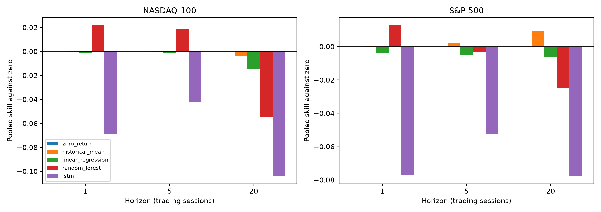
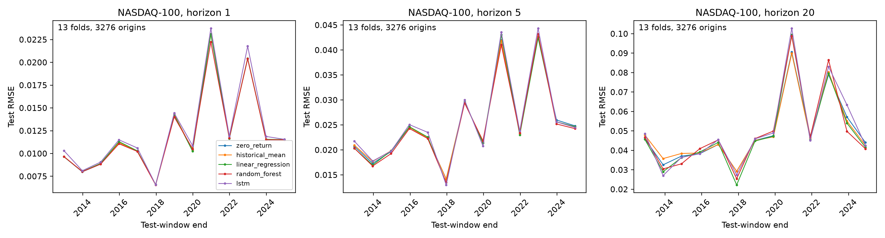
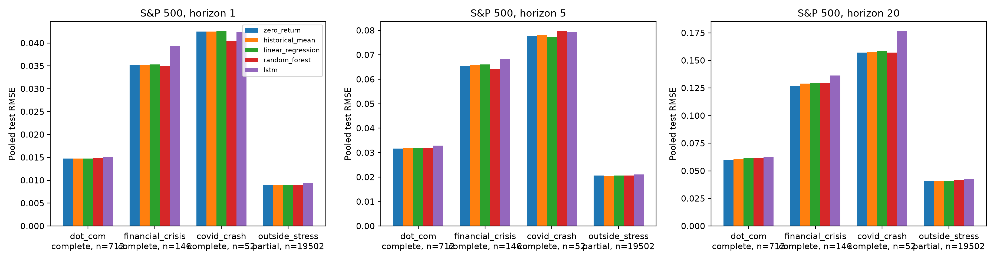
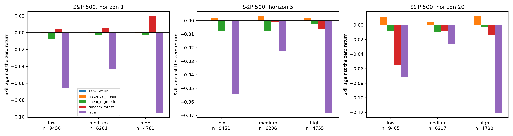

# Walk-forward forecasting and market-regime results

## Experimental setup and completion

The complete native-calendar experiment contains 282 folds and 1,410 model-fold evaluations: both index datasets, horizons 1/5/20 trading sessions, and five forecasts. All model selection uses validation RMSE; test scores are reported once. Each fold has 252 test origins, and adjacent folds advance 252 eligible sessions. Training expands from at least 2,520 embargo-clean origins, with 252 validation origins.

The saved study contains 355,320 forecast rows and 71,064 origin/horizon pairs across the six cells. The run recovered 210 existing folds and executed the remaining 72 S&P 500 twenty-session folds at the original full budgets. No smoke predictions enter these results. Recorded training runtime for new folds totals 24.21 minutes, excluding recovery auditing and aggregation; legacy runtime was not recorded.

The recovery code revision is `ce58c9263d5fabad2476b1cf46c07d7c61ae3cd9`. New folds record their generating revision and software context. The 210 recovered folds lack original revision/environment metadata: their internal consistency was checked, but their missing execution provenance cannot be established. They are not presented as 210 newly rerun experiments.

See [methodology](WALKFORWARD_METHODOLOGY.md), [recovery](RECOVERY.md), and [artifact schemas and commands](../results/walkforward/README.md).

## Data and test calendars

NASDAQ-100: 6,289 price-index sessions, 2000-01-03–2024-12-31. S&P 500: 23,323 sessions, 1927-12-30–2020-11-04. Neither dataset establishes dividend-reinvested returns. Source retrieval metadata are incomplete; raw input hashes are in the manifest. The same model inputs and protocol are used, but native test calendars differ. These are separate index case studies, not a matched cross-index comparison.

- NASDAQ-100, h=1: 13 folds; 2011-12-21 through 2024-12-30; 3,276 test origins per model.
- NASDAQ-100, h=5: 13 folds; 2011-12-15 through 2024-12-23; 3,276 test origins per model.
- NASDAQ-100, h=20: 13 folds; 2011-11-23 through 2024-12-02; 3,276 test origins per model.
- S&P 500, h=1: 81 folds; 1939-08-25 through 2020-11-03; 20,412 test origins per model.
- S&P 500, h=5: 81 folds; 1939-08-21 through 2020-10-28; 20,412 test origins per model.
- S&P 500, h=20: 81 folds; 1939-07-31 through 2020-10-07; 20,412 test origins per model.

## Pooled forecast errors and baseline skill

Errors are dimensionless log returns. Pooled RMSE is calculated after concatenating predictions, not by averaging fold RMSE. Skill is `1-MSE_model/MSE_baseline`; positive values favor the model. Model rankings here describe observed test results and are not a retuning rule.

### NASDAQ-100, 1-session horizon

- random_forest: RMSE 0.012787; MAE 0.008894; skill vs zero +0.0222; skill vs mean +0.0223.
- zero_return: RMSE 0.012931; MAE 0.008929; skill vs zero +0.0000; skill vs mean +0.0001.
- historical_mean: RMSE 0.012932; MAE 0.008928; skill vs zero -0.0001; skill vs mean +0.0000.
- linear_regression: RMSE 0.012939; MAE 0.008964; skill vs zero -0.0012; skill vs mean -0.0011.
- lstm: RMSE 0.013366; MAE 0.009293; skill vs zero -0.0684; skill vs mean -0.0684.

Pooled winner `random_forest` is best in 8/13 folds; mean fold rank 1.77, rank SD 1.12, and 7 consecutive rank changes. A pooled win does not imply a stable annual ranking.

### NASDAQ-100, 5-session horizon

- random_forest: RMSE 0.026300; MAE 0.019498; skill vs zero +0.0185; skill vs mean +0.0187.
- zero_return: RMSE 0.026546; MAE 0.019770; skill vs zero +0.0000; skill vs mean +0.0002.
- historical_mean: RMSE 0.026549; MAE 0.019772; skill vs zero -0.0002; skill vs mean +0.0000.
- linear_regression: RMSE 0.026568; MAE 0.019699; skill vs zero -0.0016; skill vs mean -0.0014.
- lstm: RMSE 0.027098; MAE 0.020091; skill vs zero -0.0420; skill vs mean -0.0418.

Pooled winner `random_forest` is best in 8/13 folds; mean fold rank 2.00, rank SD 1.41, and 7 consecutive rank changes. A pooled win does not imply a stable annual ranking.

### NASDAQ-100, 20-session horizon

- zero_return: RMSE 0.051814; MAE 0.040390; skill vs zero +0.0000; skill vs mean +0.0034.
- historical_mean: RMSE 0.051902; MAE 0.040502; skill vs zero -0.0034; skill vs mean +0.0000.
- linear_regression: RMSE 0.052189; MAE 0.039291; skill vs zero -0.0145; skill vs mean -0.0111.
- random_forest: RMSE 0.053206; MAE 0.039626; skill vs zero -0.0545; skill vs mean -0.0509.
- lstm: RMSE 0.054443; MAE 0.040367; skill vs zero -0.1041; skill vs mean -0.1003.

Pooled winner `zero_return` is best in 2/13 folds; mean fold rank 3.08, rank SD 1.33, and 10 consecutive rank changes. A pooled win does not imply a stable annual ranking.

### S&P 500, 1-session horizon

- random_forest: RMSE 0.009885; MAE 0.006588; skill vs zero +0.0131; skill vs mean +0.0126.
- historical_mean: RMSE 0.009948; MAE 0.006606; skill vs zero +0.0005; skill vs mean +0.0000.
- zero_return: RMSE 0.009951; MAE 0.006612; skill vs zero +0.0000; skill vs mean -0.0005.
- linear_regression: RMSE 0.009968; MAE 0.006630; skill vs zero -0.0036; skill vs mean -0.0041.
- lstm: RMSE 0.010326; MAE 0.006876; skill vs zero -0.0769; skill vs mean -0.0774.

Pooled winner `random_forest` is best in 32/81 folds; mean fold rank 2.19, rank SD 1.16, and 49 consecutive rank changes. A pooled win does not imply a stable annual ranking.

### S&P 500, 5-session horizon

- historical_mean: RMSE 0.022042; MAE 0.015856; skill vs zero +0.0023; skill vs mean +0.0000.
- zero_return: RMSE 0.022067; MAE 0.015926; skill vs zero +0.0000; skill vs mean -0.0023.
- random_forest: RMSE 0.022104; MAE 0.015887; skill vs zero -0.0033; skill vs mean -0.0056.
- linear_regression: RMSE 0.022125; MAE 0.015931; skill vs zero -0.0052; skill vs mean -0.0075.
- lstm: RMSE 0.022640; MAE 0.016197; skill vs zero -0.0526; skill vs mean -0.0550.

Pooled winner `historical_mean` is best in 22/81 folds; mean fold rank 2.15, rank SD 0.92, and 57 consecutive rank changes. A pooled win does not imply a stable annual ranking.

### S&P 500, 20-session horizon

- historical_mean: RMSE 0.043674; MAE 0.031963; skill vs zero +0.0094; skill vs mean +0.0000.
- zero_return: RMSE 0.043881; MAE 0.032440; skill vs zero +0.0000; skill vs mean -0.0095.
- linear_regression: RMSE 0.044023; MAE 0.032270; skill vs zero -0.0065; skill vs mean -0.0161.
- random_forest: RMSE 0.044419; MAE 0.032437; skill vs zero -0.0247; skill vs mean -0.0344.
- lstm: RMSE 0.045555; MAE 0.033066; skill vs zero -0.0777; skill vs mean -0.0880.

Pooled winner `historical_mean` is best in 19/81 folds; mean fold rank 2.16, rank SD 0.84, and 53 consecutive rank changes. A pooled win does not imply a stable annual ranking.

## Observations and interpretation

On pooled RMSE, LSTM beats the zero baseline in 0/6 pooled cells and the historical mean in 0/6. The historical motivation for neural short-horizon superiority is not automatically supported by stronger chronological testing. Raw RMSE grows with the horizon's target scale; skill is the appropriate baseline-relative comparison. Terminal-window successes must be assessed against these repeated-window results rather than carried forward as stable findings.

## Historical stress slices

Inclusive membership uses the forecast-origin date. Dot-com: 2000-03-01–2002-12-31; financial-crisis slice: 2008-09-01–2009-03-31; COVID: 2020-02-15–2020-04-30. The financial-crisis slice does not cover the entire 2007–2009 crisis. Forecast labels can realize outside a slice. Unavailable means no valid out-of-sample prediction, not zero error.

- NASDAQ-100, h=1, covid_crash: complete, 52/52 eligible origins tested; lowest RMSE `random_forest` (0.039933, skill vs zero +0.1026); zero-baseline RMSE 3.55× its outside-stress value.
- NASDAQ-100, h=1, dot_com: unavailable, 0/712 eligible origins tested; no score.
- NASDAQ-100, h=1, financial_crisis: unavailable, 0/146 eligible origins tested; no score.
- NASDAQ-100, h=5, covid_crash: complete, 52/52 eligible origins tested; lowest RMSE `random_forest` (0.067542, skill vs zero +0.0559); zero-baseline RMSE 2.75× its outside-stress value.
- NASDAQ-100, h=5, dot_com: unavailable, 0/712 eligible origins tested; no score.
- NASDAQ-100, h=5, financial_crisis: unavailable, 0/146 eligible origins tested; no score.
- NASDAQ-100, h=20, covid_crash: complete, 52/52 eligible origins tested; lowest RMSE `historical_mean` (0.144251, skill vs zero +0.0051); zero-baseline RMSE 2.96× its outside-stress value.
- NASDAQ-100, h=20, dot_com: unavailable, 0/712 eligible origins tested; no score.
- NASDAQ-100, h=20, financial_crisis: unavailable, 0/146 eligible origins tested; no score.
- S&P 500, h=1, covid_crash: complete, 52/52 eligible origins tested; lowest RMSE `random_forest` (0.040383, skill vs zero +0.0970); zero-baseline RMSE 4.71× its outside-stress value.
- S&P 500, h=1, dot_com: complete, 712/712 eligible origins tested; lowest RMSE `linear_regression` (0.014741, skill vs zero +0.0017); zero-baseline RMSE 1.63× its outside-stress value.
- S&P 500, h=1, financial_crisis: complete, 146/146 eligible origins tested; lowest RMSE `random_forest` (0.034907, skill vs zero +0.0191); zero-baseline RMSE 3.90× its outside-stress value.
- S&P 500, h=5, covid_crash: complete, 52/52 eligible origins tested; lowest RMSE `linear_regression` (0.077443, skill vs zero +0.0079); zero-baseline RMSE 3.77× its outside-stress value.
- S&P 500, h=5, dot_com: complete, 712/712 eligible origins tested; lowest RMSE `zero_return` (0.031656, skill vs zero +0.0000); zero-baseline RMSE 1.54× its outside-stress value.
- S&P 500, h=5, financial_crisis: complete, 146/146 eligible origins tested; lowest RMSE `random_forest` (0.064083, skill vs zero +0.0435); zero-baseline RMSE 3.18× its outside-stress value.
- S&P 500, h=20, covid_crash: complete, 52/52 eligible origins tested; lowest RMSE `zero_return` (0.156981, skill vs zero +0.0000); zero-baseline RMSE 3.81× its outside-stress value.
- S&P 500, h=20, dot_com: complete, 712/712 eligible origins tested; lowest RMSE `zero_return` (0.059663, skill vs zero +0.0000); zero-baseline RMSE 1.45× its outside-stress value.
- S&P 500, h=20, financial_crisis: complete, 146/146 eligible origins tested; lowest RMSE `zero_return` (0.127177, skill vs zero +0.0000); zero-baseline RMSE 3.09× its outside-stress value.

NASDAQ-100's training minimum excludes dot-com and financial-crisis origins. S&P 500 supplies those episodes. Comparisons to outside-stress rows are descriptive and are confounded by changing target scale and history. COVID samples are small; these scores do not establish crash-prediction ability.

## Volatility regimes

Each fold uses frozen 1/3 and 2/3 quantiles of trailing 20-session volatility on training origins only. No future realized volatility or full-sample threshold enters classification. Counts below are per model. Full model errors/skills/ranks and ratios to low-volatility RMSE are saved in `regime_metrics.csv`.

- NASDAQ-100, h=1, low: n=1,634; lowest RMSE `zero_return` (0.008637, skill vs zero +0.0000); zero-baseline RMSE 1.00× low-volatility RMSE.
- NASDAQ-100, h=1, medium: n=957; lowest RMSE `historical_mean` (0.011898, skill vs zero +0.0011); zero-baseline RMSE 1.38× low-volatility RMSE.
- NASDAQ-100, h=1, high: n=685; lowest RMSE `random_forest` (0.020146, skill vs zero +0.0422); zero-baseline RMSE 2.38× low-volatility RMSE.
- NASDAQ-100, h=5, low: n=1,630; lowest RMSE `random_forest` (0.018861, skill vs zero +0.0188); zero-baseline RMSE 1.00× low-volatility RMSE.
- NASDAQ-100, h=5, medium: n=966; lowest RMSE `random_forest` (0.025865, skill vs zero +0.0433); zero-baseline RMSE 1.39× low-volatility RMSE.
- NASDAQ-100, h=5, high: n=680; lowest RMSE `random_forest` (0.039104, skill vs zero +0.0022); zero-baseline RMSE 2.06× low-volatility RMSE.
- NASDAQ-100, h=20, low: n=1,643; lowest RMSE `linear_regression` (0.034831, skill vs zero +0.0814); zero-baseline RMSE 1.00× low-volatility RMSE.
- NASDAQ-100, h=20, medium: n=954; lowest RMSE `random_forest` (0.053601, skill vs zero +0.0991); zero-baseline RMSE 1.55× low-volatility RMSE.
- NASDAQ-100, h=20, high: n=679; lowest RMSE `historical_mean` (0.072604, skill vs zero +0.0009); zero-baseline RMSE 2.00× low-volatility RMSE.
- S&P 500, h=1, low: n=9,450; lowest RMSE `random_forest` (0.006779, skill vs zero +0.0038); zero-baseline RMSE 1.00× low-volatility RMSE.
- S&P 500, h=1, medium: n=6,201; lowest RMSE `random_forest` (0.008543, skill vs zero +0.0061); zero-baseline RMSE 1.26× low-volatility RMSE.
- S&P 500, h=1, high: n=4,761; lowest RMSE `random_forest` (0.015254, skill vs zero +0.0194); zero-baseline RMSE 2.27× low-volatility RMSE.
- S&P 500, h=5, low: n=9,451; lowest RMSE `historical_mean` (0.016422, skill vs zero +0.0019); zero-baseline RMSE 1.00× low-volatility RMSE.
- S&P 500, h=5, medium: n=6,206; lowest RMSE `historical_mean` (0.020331, skill vs zero +0.0031); zero-baseline RMSE 1.24× low-volatility RMSE.
- S&P 500, h=5, high: n=4,755; lowest RMSE `historical_mean` (0.031784, skill vs zero +0.0020); zero-baseline RMSE 1.94× low-volatility RMSE.
- S&P 500, h=20, low: n=9,465; lowest RMSE `historical_mean` (0.035392, skill vs zero +0.0112); zero-baseline RMSE 1.00× low-volatility RMSE.
- S&P 500, h=20, medium: n=6,217; lowest RMSE `historical_mean` (0.043103, skill vs zero +0.0043); zero-baseline RMSE 1.21× low-volatility RMSE.
- S&P 500, h=20, high: n=4,730; lowest RMSE `historical_mean` (0.057295, skill vs zero +0.0119); zero-baseline RMSE 1.62× low-volatility RMSE.

Higher absolute error can follow higher target volatility without worse relative skill. Regime rankings and annual rankings answer different questions; neither is evidence of a universally superior model.

## Figures

Generated at 220 DPI from actual saved forecasts/metrics; no synthetic series contributes. Axis values are errors in log-return units or MSE-based skill.

## Verification and reproducibility

`python scripts/verify_walkforward.py` independently validates all 282 planned folds against source data, checks original recovered checksums, and recomputes pooled/stress/regime metrics. The full runner rejects corrupt or incompatible resume inputs. See `verification.json` for machine-readable completion. Use `python scripts/report_walkforward.py` to regenerate this report after auditing. Local Ruff lint/format checks and 67 pytest tests passed with PyTorch installed; CI additionally exercises neural smoke and the saved-study audit.

New training ran on Apple M2 Pro (10 CPU cores, 16 GiB memory), CPU PyTorch with six intra-operation threads. Full software versions and platform are in the manifest, environment record, per-new-fold reports, and pinned recovery dependency inventory. Bitwise cross-platform neural reproduction is not promised. Original raw files and Phase 3 artifacts were not replaced.

## Failure analysis and threats to validity

No planned fold or required model is omitted from the completed native-calendar matrix. Legacy provenance remains incomplete. Only one random seed and small predeclared tuning grids were evaluated. Weight checkpoints are not serialized. Overlapping horizon labels, shared training history, volatility clustering, and market nonstationarity preclude iid significance claims. No formal significance test or uncertainty interval was run. Source acquisition metadata are incomplete, early S&P history predates the modern index, and aggregate indexes cannot measure point-in-time constituent/survivorship effects. Stress boundaries are fixed and narrow, episode counts are small, and no boundary-sensitivity study was performed. Different native index calendars do not demonstrate transfer to an unseen market. No transaction-cost, portfolio, or profitability evaluation is included.

## Next combined research cycle

Run a predeclared matched-calendar comparison with common fold dates and comparable training histories, then quantify model/seed uncertainty using multiple fixed seeds and dependence-aware block resampling. Compare observed skill and rank stability without choosing favorable seeds or episodes. Add chronological interval calibration and regime-specific coverage diagnostics as a separate uncertainty task. Preserve the current single-seed study and artifact hashes as the baseline; recover complete execution provenance through a separately budgeted fresh run rather than relabeling legacy results.
