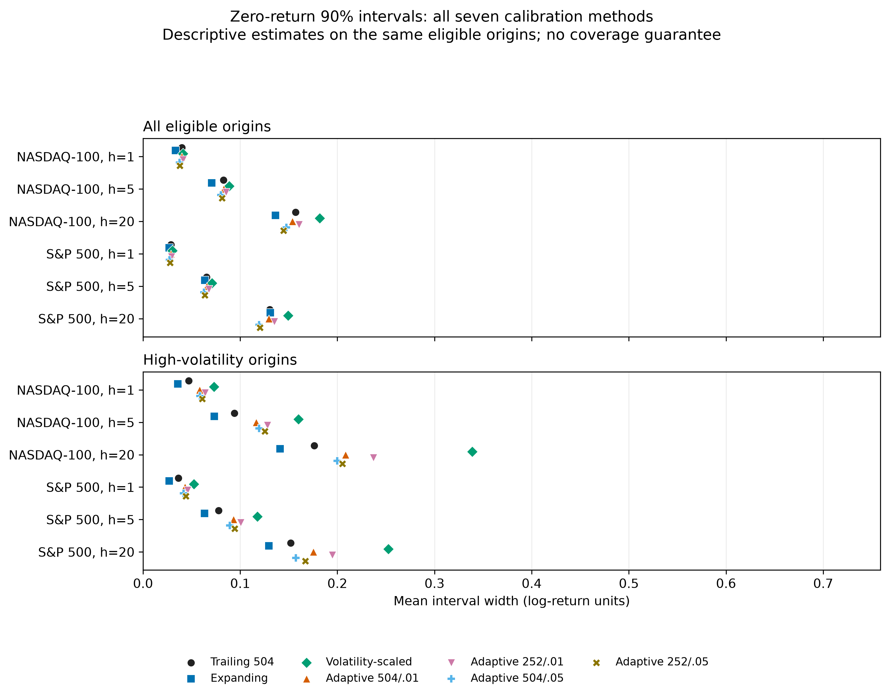

# MarketPulse: Retrospective Evidence on Forecast Complexity, Temporal Robustness, and Delayed Uncertainty Calibration

Yug More

## Abstract

We investigate whether greater model complexity yields reliable improvements in financial return forecasting under a common chronological evaluation protocol. Two repository price-index histories support {{C01}} expanding-window folds and {{C02}} out-of-sample model forecasts at horizons of 1, 5 and 20 sessions. Zero return, a frozen training-target mean, standardized linear regression, random forest and a one-layer sequence LSTM are evaluated on shared origins. Random forest has the smallest native pooled RMSE in three index/horizon cells, but no random-forest improvement over either simple baseline survives the original 18-comparison Holm family. The LSTM has the largest pooled RMSE in all six native cells. Expanded five-seed sensitivity covers {{C36}} selected folds rather than the full history; no ML improvement over either baseline survives its separate 30-comparison family, and NASDAQ-100 long-horizon LSTM ranks still range from first to fifth. Four bounded, delayed-feedback adaptive interval variants are evaluated retrospectively. The designated variant has {{C15}} adjusted interval-score improvements within a 60-comparison family, confined to S&P 500 short horizons, while long-horizon undercoverage and {{C19}} nominal-level nesting violations persist. Historical rehearsals are not independent confirmation. These results support a qualified comparison of the tested procedures, not universal model inferiority, unseen-market generalization, distribution-free coverage or economic profitability. <!-- evidence: C01,C02,C08,C09,C12,C15,C19,C24,C35,C36 -->

## 1. Introduction and motivation

Forecasting financial returns is an unusually demanding prediction problem. The target is small relative to its variation, observations arrive in temporal order, and the relationship between available predictors and future outcomes may change over a long history. These features make a favorable result on one interval difficult to distinguish from a transient fit, an evaluation choice, or ordinary sampling variation. A model's flexibility can represent nonlinear patterns, but flexibility alone says nothing about whether those patterns persist out of sample. Empirical performance must be established against transparent reference forecasts on observations that were not used to fit or select each model.

Simple forecasts are therefore substantive benchmarks. A zero-return forecast and a historical-mean forecast encode different assumptions while requiring little model selection. Evidence that a complex model beats one benchmark on one horizon is narrower than evidence of a stable improvement across horizons, periods, and evaluation populations. Repeatedly examining the same history can also make the best observed model appear more reliable than it is; a correction over a declared set of comparisons helps with that set but cannot erase earlier exposure to the data. The problem is particularly acute in financial applications, where a single long historical path is often reused for specification and evaluation [@white2000].

The evaluation design must respect that path. Randomly mixing dates between training and test sets can let information from later regimes influence an earlier forecast assessment. Chronological, expanding-window evaluation instead asks how a procedure trained on information available up to a date performs on subsequent origins. Even then, a single retrospective path cannot establish future stability. Rankings may depend on the horizon, market series, test population, fold, or stochastic initialization. A model ranking is thus a property of the full evaluation protocol and sample, not an intrinsic ordering of algorithms.

Point accuracy is only one dimension of a forecast. An interval can achieve a target empirical coverage by being very wide, while a sharp interval can miss too often. Proper interval scores combine width and miss penalties, but coverage, sharpness, and score answer related rather than interchangeable questions. Delayed adaptive calibration raises an additional question: whether feedback from outcomes that have fully matured improves these empirical trade-offs, and whether resulting intervals remain nested across nominal levels. A method's empirical scores do not by themselves imply a finite-sample or distribution-free guarantee.

MarketPulse asks four bounded questions. First, do the tested random-forest and one-layer LSTM procedures improve on zero-return and frozen historical-mean forecasts under shared chronological evaluation? Second, how sensitive are descriptive rankings to horizon, native versus endpoint-matched populations, selected folds, and random seeds? Third, do fixed and delayed adaptive intervals improve coverage and proper interval scores without obscuring width, undercoverage, or violations of interval nesting? Fourth, which conclusions can be reconstructed from the saved predictions and analysis artifacts, and which remain limited by missing provenance, weights, or unseen data?

This study contributes a common-target comparison across two stored index histories, a bounded sensitivity analysis that makes its selected-fold and seed coverage explicit, and an empirical uncertainty analysis that reports failures as well as scores. Its contribution is evidentiary rather than architectural: it documents what these stored experiments support and what they do not. The canonical comparison follows an earlier collaborative course project whose notebooks had non-comparable targets, samples, and outputs; those historical materials are context, not additional independent replications. <!-- evidence: E:history -->

All findings are retrospective. The model families and historical series had already been examined before follow-up inference and calibration analyses. Freezing a follow-up configuration before its execution does not make the underlying data untouched, and no prospective or independent chronological validation outcome is available. <!-- evidence: C04; E:protocols -->

## 2. Research questions and contributions

RQ1 asks whether random forest or the canonical LSTM improves return errors consistently over zero and historical-mean forecasts. RQ2 asks how rankings depend on horizon, native versus common-calendar evaluation, selected periods and random seeds. RQ3 asks whether fixed or delayed adaptive intervals improve coverage and proper scores without hiding width or nesting failures. RQ4 asks which conclusions can be reconstructed from stored predictions and which require new data or missing execution artifacts.

This study contributes a common-target comparison across two stored index histories, a bounded analysis of temporal and seed variation, and an uncertainty evaluation that reports failures alongside scores. A machine-readable manifest links numerical claims to source artifacts. The contributions are empirical and engineering; we propose no new architecture, inferential theorem, or trading strategy. <!-- evidence: C07,C10,C11,C13,C14; E:history -->

## 3. Related work

The comparison of forecasting models is inseparable from the benchmark and target used to define success. In equity-premium prediction, Campbell and Thompson evaluate out-of-sample forecasts relative to the historical average and study economically motivated restrictions [@campbell2005]. That literature makes a historical reference forecast an essential part of an empirical comparison, rather than a ceremonial baseline. MarketPulse uses both zero return and a training-only historical mean, but its target is a log change in stored index closes at daily, five-session, and twenty-session horizons. It is not a replication of monthly dividend-inclusive equity-premium forecasting; the saved files do not establish total returns or point-in-time constituents. <!-- evidence: E:data; E:models -->

Machine-learning comparisons add model-selection choices to the benchmark question. Random forests aggregate tree predictors [@breiman2001], and long short-term memory networks use gated recurrent state updates [@hochreiter1997]. These architectures motivate the two model families tested here, but neither reference implies that nonlinear or recurrent structure should improve a particular return target. The canonical search spaces are deliberately limited; the results therefore concern one configured forest and one one-layer LSTM, not the full families of tree ensembles, recurrent networks, or modern deep models. The relevant empirical question is whether added flexibility improves forecasts on later observations after model selection is kept inside the training history.

That question also depends on how time is partitioned. Standard random cross-validation can be inappropriate when training and test observations are temporally dependent or the target is constructed from overlapping future windows. Research on time-series cross-validation explains that validity depends on the data-generating and forecasting setting, rather than a blanket rule that every form of cross-validation is invalid [@bergmeir2018]. MarketPulse uses expanding training histories, later validation and test blocks, and a horizon-specific purge at each boundary. This choice preserves the direction of information flow in the saved evaluation. It does not remove nonstationarity, make adjacent multi-session targets independent, or supply an untouched future sample.

Comparing predictive accuracy requires paired losses because competing procedures forecast the same realized outcomes. Diebold and Mariano provide a framework for testing predictive accuracy through loss differentials [@diebold1995]. HAC covariance estimation [@newey1986] and block resampling for dependent observations [@kunsch1989] provide different ways to account for serial dependence under assumptions. MarketPulse reports the sign and magnitude of paired squared-loss differences, marginal moving-block intervals, nominal normal-reference p-values, and Holm-adjusted p-values separately. These inferential quantities have different roles: an effect describes direction and scale, a marginal interval summarizes resampling uncertainty, and a p-value addresses a specified null under the chosen approximation. None establishes practical importance or equivalence.

Multiplicity is especially relevant when several models, markets, and horizons are compared and when the same history informed earlier choices. White's Reality Check formalizes one approach to model-search data snooping [@white2000]. MarketPulse does not implement that procedure; it applies Holm's step-down procedure [@holm1979] within three predeclared computational comparison families: the original 18 point-loss contrasts, an expanded 30-comparison seed sensitivity family, and a 60-comparison adaptive interval-score family. Each adjustment controls only its listed family. It cannot account for the full project history or unrecorded analyst choices, so corrected results remain retrospective evidence rather than prospective confirmation. <!-- evidence: E:protocols -->

Forecast uncertainty adds criteria beyond point-error rankings. Strictly proper scoring rules reward honest probabilistic forecasts and make the width-versus-miss trade-off explicit [@gneiting2007]. Adaptive conformal inference studies feedback-based adjustment of a miscoverage parameter under distribution shift [@gibbs2021], while later work examines conformal prediction beyond exchangeability under specified conditions [@barber2023]. MarketPulse borrows the empirical question of whether delayed outcome feedback changes observed coverage and interval scores, but its clipping, maturity rule, rolling histories, and repeated model refitting define a different procedure. The cited theory does not confer coverage guarantees on these implementations. We therefore evaluate observed coverage, width, proper score, and nesting separately.

## 4. Datasets and provenance

{{DATASETS}}

The NASDAQ-100 file has a yfinance-style multirow header and a notebook download call, but no retrieval timestamp or library version. The recorded exclusive-end request does not literally explain the final saved session. The S&P 500 file is described as a Kaggle download without a source URL, version or retrieval timestamp. Its adjusted-close column equals close throughout; early zero volume lacks an established interpretation. Neither file establishes dividend-reinvested total returns, current licensing rights or point-in-time index constituents. We preserve the raw bytes rather than asserting a new independent acquisition. The long S&P-labelled series includes observations predating the modern index. <!-- evidence: E:data -->

The data loader validates ordering, duplicates, missing/nonfinite values and positive prices; it does not interpolate, reorder or silently delete observations. Model eligibility additionally requires finite targets and complete causal feature histories. Calendar closures remain in the observed session sequence. Different index calendars and unequal training histories prevent raw-error cross-index rankings. The shared-calendar analysis matches both origin dates and actual target endpoints but does not equalize the information used to train the models. <!-- evidence: C11; E:loader -->

## 5. Experimental methodology

### 5.1 Target, information set and features

At the close of session $t$, the target is $y_t^{(h)}=\log(P_{t+h}/P_t)$ for $h\in\{1,5,20\}$ observed sessions. Features may use prices through the origin close. They comprise daily log return at lags 0, 1 and 5; 5/20-session momentum; trailing 5/20-session mean returns; trailing 20-session return standard deviation with one degree-of-freedom correction; log distance from the trailing 20-session price mean; and a 14-session RSI computed from rolling gains/losses. RSI with no gains and no losses is undefined. Volume is excluded because its early interpretation is incomplete. <!-- evidence: E:features; E:protocols -->

The configured horizons of 1, 5 and 20 sessions represent a one-session forecast and approximate weekly and monthly session spans. This is a scope choice for comparing different forecast lengths under one protocol; it is not a claim that these horizons are uniquely standard or independent. The files' differing calendars mean the horizons count observed sessions within each index. <!-- evidence: E:protocols -->

The feature matrix can be computed over the complete offline file because every transformation is causal; prefix/future-perturbation tests check this property. Eligibility is defined separately for each horizon using a complete 20-row feature lookback and a finite forward label. This avoids silently shifting the supervised target relative to a sequence's final feature row. It does not establish that the researcher had never previously seen the historical period. <!-- evidence: E:features; E:tests -->

### 5.2 Models and baseline definitions

Zero return predicts zero without estimation. Historical mean predicts the arithmetic mean of embargo-clean training targets and keeps it fixed during the evaluation block. Linear regression uses ordinary least squares after a scaler fitted only on training-origin features. Zero predicted directions do not count as matching nonzero outcome directions; zero actual outcomes are excluded from directional accuracy. <!-- evidence: E:models; E:metrics -->

These two forecasts provide distinct low-complexity reference points: zero return encodes no conditional directional forecast, while the training mean estimates a constant target level from the available past. They are predictive benchmarks, not trading strategies, and neither is guaranteed to be optimal for a particular index or horizon. <!-- evidence: E:models -->

The random forest uses 200 trees, minimum leaf size 5 and depth selected from 4 or 8 by validation RMSE, with smaller depth breaking ties. It uses the same training-only standardization. The recorded source leaves other scikit-learn settings at library defaults; these are a version-dependent part of reproduction, not a broader hyperparameter search. The LSTM has one recurrent layer, a 20-session input window, and a linear readout at its final step. Hidden size is selected from 16 or 32 by validation RMSE, with smaller size breaking ties. Training uses CPU float32 tensors, Adam with learning rate 0.001, batches of 256, at most 25 epochs and patience 5, restoring the best validation weights. Batch shuffling occurs within training, not across chronological partitions. Scaling uses training-origin rows before window extraction. <!-- evidence: E:models; E:protocols -->

The original protocol records seed 171; the sensitivity seeds are 171, 271, 371, 471 and 571. Python, NumPy and PyTorch seeds are set. Varying seeds probes sensitivity to randomized estimator and training states on the selected folds. It does not estimate performance over a population of market histories, and its limited fold coverage cannot establish full-history seed stability. Saved outputs and targeted reruns support numerical checks, but unsaved weights and incomplete legacy versions preclude a claim of bitwise cross-platform replay. No canonical Deep LSTM or boosting model is added by importing historical notebook names into this comparison. <!-- evidence: C03,C07; E:models; E:history -->

## 6. Walk-forward evaluation protocol

Each native fold uses at least 2,520 training origins, 252 validation origins and 252 test origins. The generator anchors the latest test window at the terminal eligible origin, then moves backward by 252 eligible origins; chronological ordering yields expanding training histories. On the actual files, eligible origins have no internal session gaps, so this step equals 252 observed sessions. The study has 13 NASDAQ-100 folds and 81 S&P folds at each horizon, totaling {{C01}} folds and {{C27}} origin/horizon pairs. The model forecasts repeat each pair across the five procedures; they are not {{C02}} independent market observations. <!-- evidence: C01,C02,C27; E:folds -->

For a later block beginning at raw row $s$, an earlier origin is admissible only if $t+h<s$. Labels touching the later boundary are purged from train/validation and validation/test. The rule conservatively excludes an outcome realized on the current decision date. Within-run candidate selection and early stopping use validation only. A selected model remains fixed through its annual test block, while new causal feature observations become available at each origin. This is annual-block refitting, not daily retraining. <!-- evidence: E:folds; E:models -->

Volatility regimes use trailing 20-session daily-return standard deviation known at the origin. Terciles are fitted at training origins and frozen per fold: low at or below the lower threshold, medium above it through the upper threshold, and high above the upper threshold. Equal thresholds need not produce a nonempty middle category. Historical stress membership uses inclusive forecast-origin dates: 2000-03-01--2002-12-31, 2008-09-01--2009-03-31, and 2020-02-15--2020-04-30. Target realizations may lie outside the episode. NASDAQ lacks eligible tests in the first two slices under the training minimum. Short slices and missing support must not be described as replicated crisis prediction. <!-- evidence: E:regimes; E:folds -->

## 7. Metrics, statistical tests and multiplicity

### 7.1 Point and interval losses

RMSE is the square root of the mean squared residual, MAE the mean absolute residual, and bias the mean prediction minus outcome. Baseline-relative MSE skill is $1-\mathrm{MSE}_{model}/\mathrm{MSE}_{baseline}$ on identical origins and endpoints. Pooled errors concatenate forecasts before evaluation; they are not means of per-fold RMSE. A historical-mean forecast retains its own fold's frozen training mean. The reported rank is within an index/horizon/population, with rank 1 minimizing RMSE. <!-- evidence: C10,C11; E:metrics -->

For nominal coverage $c$ and interval $[l,u]$, the central interval score is

$$
IS_c(l,u;y)=(u-l)+\frac{2}{1-c}(l-y)1\{y<l\}+\frac{2}{1-c}(y-u)1\{y>u\}.
$$

This is the implementation's width plus twice-per-tail miss penalty, expressed using indicators for observations below and above the interval. Lower scores balance narrower widths against penalties for misses. Scores use the fixed nominal coverage, even when an adaptive method changes its internal quantile level. Coverage counts inclusive boundary hits. A lower score does not logically require coverage closer to nominal. <!-- evidence: E:calibration -->

### 7.2 Dependence-aware comparisons

For aligned forecasts, define a paired loss differential $d_t=L_{a,t}-L_{b,t}$; negative values favor the first procedure. Moving-block resampling preserves paired values and raw-session continuity. Candidate blocks cannot cross structural gaps between selected folds. The final resampled block may be shorter to retain the original sample size. Percentile intervals use 2,000 replicates at 95% nominal confidence. The primary length is 20; 40 and 80 are sensitivities. These are marginal intervals, not simultaneous familywise bands. <!-- evidence: E:statistics; E:protocols -->

The Bartlett HAC estimate uses autocovariances through lag $L-1$ with weights $1-k/L$. The statistic divides the mean loss differential by its estimated standard error and uses a two-sided normal reference. Regime inference resamples the original timeline together with membership indicators, rather than making separated high-volatility days artificially adjacent. Its conditional influence includes the selected-population proportion. A minimum of ten nominal block equivalents is a screening heuristic, not an effective-sample-size estimate. Small slices remain descriptive. <!-- evidence: E:statistics -->

Long nonstationary histories, overlapping multi-session targets and shared expanding training histories weaken inferential assumptions. HAC and bootstrap agreement cannot prove their validity under arbitrary dependence. We report effects, marginal intervals, nominal p-values and adjusted p-values separately; nonsignificance is not an equivalence test. <!-- evidence: E:statistics -->

### 7.3 Separate comparison families

The original family contains 18 native-calendar squared-loss comparisons: RF versus zero, historical mean and LSTM in each index/horizon cell at length 20. The expanded sensitivity family contains 30 overall comparisons: RF and LSTM each versus both baselines, plus RF versus LSTM, in the six cells. Five-seed losses are averaged at each origin; predictions are not averaged into an ensemble, and seeds do not multiply temporal sample size. The adaptive family contains 60 designated-variant versus trailing interval-score comparisons: all point-model cells and both coverage levels. Each family receives its own Holm adjustment. Alternative lengths, regimes and adaptive settings are exploratory. None of these families corrects for all project-wide historical selection. <!-- evidence: C33,C34,C35; E:protocols -->

## 8. Experimental results

### 8.1 Native pooled errors

Table 1 presents every canonical model and native index/horizon cell. Values are rounded only for display; the evidence CSVs retain the saved precision. RMSE has log-return units, while squared-loss effects below have squared-log-return units. Different horizons have different target scales, so larger raw long-horizon error is not itself evidence of lower predictability. <!-- evidence: C10 -->

{{POINT_TABLE}}

RF minimizes pooled RMSE for NASDAQ h1/h5 and S&P h1, while zero wins NASDAQ h20 and historical mean wins S&P h5/h20. LSTM has the largest native pooled RMSE in all six cells. These descriptive rankings do not establish corrected evidence of baseline superiority. <!-- evidence: C10,C24 -->

### 8.2 Paired effects and corrected evidence

Table 2 includes the complete original primary family. It preserves negative, unfavorable and null findings instead of showing only nominally significant or favorable comparisons. The two p columns are unadjusted normal-reference and within-family Holm-adjusted values, respectively. The confidence interval is the marginal moving-block interval, not an interval obtained by inverting the Holm test. <!-- evidence: C34 -->

{{INFERENCE_TABLE}}


For NASDAQ h1, the RF-minus-zero mean squared-loss difference is {{RF_NDX1_EFFECT}} (marginal block interval {{RF_NDX1_CI}}; nominal p={{RF_NDX1_P}}, Holm p={{RF_NDX1_ADJ}}). Its negative sign favors RF, but its interval includes zero and its family-adjusted p-value does not support an improvement. In contrast, the two S&P h20 RF comparisons are unfavorable: versus zero, the difference is {{RF_SP20_EFFECT}} (interval {{RF_SP20_CI}}; nominal p={{RF_SP20_P}}, Holm p={{RF_SP20_ADJ}}); versus historical mean, the source estimate is positive and the adjusted comparison also rejects equal mean squared loss in the direction of higher RF loss. The original 18-test family includes six RF-versus-LSTM comparisons in addition to the twelve RF-versus-baseline comparisons shown in the figure. RF has Holm-adjusted evidence of lower loss than LSTM in five cells, yet no adjusted evidence of improvement over either simple baseline. These statements are compatible: outperforming the LSTM does not imply outperforming a simple forecast. The correction is limited to those 18 comparisons and does not cover the entire project history. <!-- evidence: C09,C26,C34,C39,C40 -->

## 9. Robustness and sensitivity

The original seed study selected earliest/middle/latest folds per cell; the expansion added intervening quarter-position folds at the same budgets. Combined sensitivity covers {{C36}} distinct folds and {{C06}} origins per cell, conditional on the five seeds. The added {{C05}} training runs generated {{C37}} stochastic forecasts; this is not five-seed replication of all {{C01}} historical folds. Deterministic predictions are reused on the same selected origins rather than represented as independently trained repetitions. <!-- evidence: C01,C05,C06,C07,C36,C37 -->

{{SEED_TABLE}}

The expanded NASDAQ h20 LSTM ranks range from first to fifth across the five fixed seeds. This range makes a single winning initialization a poor summary of optimizer sensitivity; choosing the best seed after inspecting outcomes would condition the reported result on the same evaluation data. The selected folds are dispersed across each series, but they remain only 30 folds and do not estimate full-history replication. No ML improvement over either baseline survives the separate 30-comparison Holm family. Seed-averaged loss is the result for the specified average-over-seeds analysis, not a sample of independently realized market histories. Within each cell, models share origins, endpoints, and labels, which makes their paired comparisons meaningful while leaving the tested market histories unchanged. <!-- evidence: C08,C12,C33 -->

Endpoint matching in the full historical study retains 2,232 origins per index/horizon. S&P h5 then has linear regression as the RMSE winner, unlike its native historical-mean winner. This is evaluation-population sensitivity, not evidence of a changed model or a common training history. The selected seed-study calendars have no shared cross-index endpoints, so a cross-index matched seed result is unavailable. Volatility and stress summaries are descriptive where sample support is limited; complete regime/stress evidence is retained in the repository. <!-- evidence: C10,C11,C25,C30; E:regimes -->


## 10. Predictive uncertainty and calibration

### 10.1 Fixed prequential intervals

At origin $t$, a previous residual is usable only if its actual target endpoint date is strictly before $t$. Trailing calibration retains the latest 504 mature absolute residuals, with minimum 252. Expanding calibration uses all mature residuals. Volatility-scaled calibration divides the prior absolute residual by causal volatility at its own origin, then rescales the selected quantile by current causal volatility. The order-statistic rank is $\lceil(n+1)c\rceil$; the public quantile helper returns infinity if that rank exceeds the history rather than silently clipping it. Configured histories make both levels finite. Warmup exclusions remain recorded. <!-- evidence: E:calibration; E:protocols -->

These intervals calibrate an annually refitted procedure. Earlier OOS outcomes can later enter point-model training. Thus this is not a held-out split-conformal guarantee for one permanently fixed fitted model. All comparisons retain identical eligible origins, and no future realized volatility is used. Nominal coverage is evaluated at 80% and 90%, globally and by regime/stress support. <!-- evidence: E:calibration; E:tests -->

### 10.2 Delayed adaptive variants

The adaptive variants use windows 252/504 and update rates 0.01/0.05, with a minimum 252 residuals. Each nominal level has its own state initialized to its target miscoverage. Only a mature, previously eligible interval supplies its own miss indicator $e_i$. The update is $\alpha\leftarrow\mathrm{clip}(\alpha+\gamma((1-c)-e_i),0.02,0.5)$. Warmup forecasts provide residuals but no invented interval feedback. The radius uses rank $\lceil(n+1)(1-\alpha)\rceil$. Clipping and delayed feedback are deliberate differences from theoretical ACI; no arbitrary-dependence or finite-sample guarantee is asserted. <!-- evidence: E:adaptive; E:protocols -->

The designated sensitivity uses window 504 and rate 0.01; it was not chosen as the winner of the retrospective evaluation. All four variants remain available. The extension stores {{C13}} method-origin records and checks {{C14}} eligible level/bound pairs. Repeated methods/levels do not create additional independent outcomes. <!-- evidence: C13,C14; E:adaptive -->

### 10.3 Coverage, width and interval scores

Table 4 shows all index/horizon cells for zero-return 90% intervals under trailing, designated adaptive and volatility scaling. This is a clearly labelled view of the method trade-off, not a restriction of the statistical family to the best-looking point model. Complete files include both levels, all point models, all four adaptive variants and the fixed expanding alternative. <!-- evidence: C17,C18,C35 -->

{{CALIBRATION_TABLE}}




The designated variant has {{C15}} adjusted score improvements, all S&P h1/h5 comparisons across point models and nominal levels. None of its NASDAQ or h20 primary improvements survives correction. For illustration, NASDAQ h1 historical-mean 80% score improvement has nominal p={{ACI_NOMINAL_P}} but Holm p={{ACI_ADJUSTED_P}}. Selecting only its nominal significance would misstate the result. A small adjusted p-value elsewhere remains retrospective evidence under the inferential approximation, not future calibration assurance. <!-- evidence: C15,C16,C35 -->

For S&P zero-return h20 90% intervals, designated adaptive coverage is {{SP20_COVERAGE}} versus {{SP20_TRAILING_COVERAGE}} for trailing calibration, despite a lower mean proper score for the adaptive procedure. This illustrates why coverage and interval score cannot be substituted for one another: the score aggregates width and miss penalties, while coverage records only the fraction of realized outcomes inside the bounds. At NASDAQ h20 in high-volatility origins, designated adaptive coverage remains below the 0.90 target; volatility scaling covers more broadly but does so with substantially wider intervals. These empirical trade-offs do not establish universal calibration superiority or a coverage guarantee. <!-- evidence: C17 -->

### 10.4 Failure cases: clipping and nonnested levels

{{NESTING_TABLE}}

Independent level states can give an 80% interval wider than its 90% counterpart. The designated variant has {{C19}} such violations among {{C20}} eligible method-origin pairs. Faster variants have substantially more. Counts are accumulated across repeated model procedures and are not independent samples. Alpha clipping is also measured. No hull, monotonic projection or parameter retuning was applied after inspection. Enforcing nesting would define a different method requiring a separately declared evaluation. These experimental variants should not be described as a verified coherent multilevel forecasting system. <!-- evidence: C19,C20,C21,C22,C23; E:diagnostics -->

## 11. Discussion and interpretation

For RQ1, the evidence does not show that the tested complexity reliably improves on simple forecasting rules. RF's best native pooled RMSE occurs in three of six cells, while zero return or historical mean leads in the other three; LSTM has the highest pooled RMSE in every native cell. These rankings describe the saved aggregate errors. They do not prove universal RF advantage or universal LSTM inferiority: model rankings vary with horizon and evaluation population, and the canonical searches represent only narrow implementations. Paired inference sharpens but does not reverse this interpretation. RF's corrected comparisons with LSTM favor RF in five of six cells, whereas none of its comparisons with a simple baseline establishes an adjusted improvement. At S&P h20, the corrected direction is adverse to RF against both simple forecasts. The practical implication is that the benchmark choice matters: a complex model can beat another complex model while remaining unsupported against a simple forecast.

For RQ2, native and endpoint-matched rankings differ in at least one reported cell, and the five-seed selected-fold sensitivity exposes material optimizer variation for the NASDAQ h20 LSTM. Matching origin and endpoint calendars improves comparability of evaluation outcomes, but the models retain their historically different training data and dates. The matched analysis therefore isolates an evaluation-population change; it is not a controlled comparison with identical training histories. Likewise, selected-fold seed ranges answer a limited question about randomized fits on chosen periods. They cannot establish full-history stability. These are observed sensitivities; attributing them to a particular market mechanism or optimizer dynamic would require additional evidence and is not attempted here.

For RQ3, the designated adaptive method's 20 Holm-adjusted interval-score improvements all occur in S&P h1 or h5 comparisons within the prespecified 60-test family. This concentration is evidence against a blanket claim of method-wide superiority. Coverage, width, and proper score can move differently: the S&P h20 example has lower adaptive score but lower coverage than trailing intervals, and high-volatility NASDAQ h20 coverage remains below nominal for the designated adaptive procedure. The 1,494 designated-variant nesting violations further show that independently updated nominal levels did not always produce ordered intervals. The algorithm's delayed feedback and clipping are implementation choices, and no distribution-free guarantee follows from the empirical comparison. The result is a measured score advantage in a bounded subset, accompanied by clear calibration failure cases.

For RQ4, saved prediction records and processing scripts allow extensive arithmetic reconstruction, but reproducibility is partial. Processed outputs do not restore missing acquisition timestamps, rights, historical execution environments, or model weights. A recovery-time hash verifies the bytes currently held; it does not prove when or how the source was obtained. Historical Phase 9 rehearsals assess intake and execution procedures and do not serve as independent validation. Consequently, the strongest interpretation is about procedures applied to the two stored histories under this retrospective protocol. It does not generalize to unseen markets or future regimes.

Taken together, the findings support a methodological lesson, not a market claim: baseline performance, temporal stability, corrected inferential evidence, and uncertainty quality should be reported as separate properties. Model complexity, a favorable point rank, or one significant interval score is insufficient on its own. No experiment here models execution, turnover, transaction costs, portfolio constraints, or realized investment utility. Statistical accuracy cannot be converted into a profitable strategy claim, and null comparisons do not prove equivalence. The results neither establish market efficiency nor rule out other architectures, features, or data sources. <!-- evidence: C07,C10,C11,C17,C24,C26 -->

## 12. Threats to validity and limitations

Researcher selection remains material: the histories were already available, and multiple project stages exposed related outcomes. The declared comparison families constrain individual follow-ups without undoing project-wide exposure. No untouched confirmatory period has been scored. Phase 9's four-block historical rehearsal tests infrastructure only; its model evaluations are not independent chronological validation. The fixed prospective origin and outcome-maturity gates are not a substitute for actually acquired, provenance-reviewed future observations. <!-- evidence: C04,C28,C29; E:prospective -->

The two dependent US indexes do not constitute independent cross-market replication. Their coverage, construction and training histories differ. The raw files lack complete acquisition versions/timestamps and license provenance. Aggregate index closes do not identify constituent survivorship or dividend reinvestment. Early S&P-labelled values do not establish a modern-index population throughout the full series. Calendar gaps were preserved, not independently matched to every historical exchange closure. <!-- evidence: E:data -->

Dependence is not exhausted by the tested block lengths: long-memory dynamics, structural changes and repeated estimation can invalidate normal-reference and bootstrap approximations. Short crisis episodes provide few effective observations, while unavailable NASDAQ episodes cannot support claims. Seed replication covers selected folds; training budgets and candidate grids are limited. There is one canonical recurrent architecture, not a comprehensive neural benchmark. <!-- evidence: C07; E:statistics; E:regimes -->

The {{C03}} recovered legacy folds have validated records but lack original generating revisions, environments and runtimes. A recovery-time hash is not original acquisition or execution metadata. Model weights are not serialized, and targeted numerical reproduction cannot prove the exact historical training process or platform-independent equality. Original notebook follow-up files are also missing. We preserve these distinctions instead of claiming complete raw-acquisition-to-weight replay. <!-- evidence: C03; E:history -->

The manuscript and its claim audit are generated from saved evidence and checked computationally within the same workflow. This is not blinded external human peer review. Formal external scrutiny and author/submission decisions remain necessary before a journal or conference submission.

## 13. Conclusions and future work

Under the tested retrospective protocol, model complexity does not establish reliable superiority over simple return baselines. Random-forest point wins are conditional on horizon and population; LSTM pooled errors and seed instability caution against selecting attractive local results. Adaptive score improvements are limited to specified comparisons and coexist with undercoverage, clipping and nonnested intervals. Null findings do not establish equivalence or universal inferiority. <!-- evidence: C08,C09,C10,C12,C15,C19,C24 -->

Future work should execute the frozen prospective protocol only after enough complete, unexposed observations and actual target outcomes exist; acquire additional markets with verifiable source/version/license records; preserve fitted weights and explicit software defaults; and separately predeclare any revised interval-nesting or dependence method. Economic evaluation would require its own decision loss, execution assumptions and costs. These are unresolved research tasks, not experiments claimed to have run.

## Acknowledgments and contribution disclosure

The original collaborative course project included NASDAQ work by Yug More and S&P work by Srihan Cheemangunta. This records historical contributions and does not assert final manuscript coauthorship or submission consent. Current affiliations, final authorship, contribution statements, and consent must be confirmed before any submission. No institutional endorsement or funding relationship is inferred. This is an unpublished research draft and has not undergone external peer review. <!-- evidence: E:history -->

## References

{{REFERENCES}}

## Reproducibility appendix

All displayed numeric precision is presentation rounding of saved values; source CSVs and the machine-readable audit retain the underlying values. The evidence manifest maps every claim in the source manuscript to the frozen Phase 12 registry and records SHA256 digests for the supporting artifacts. Table sources and selected rows are recorded with the manuscript. These mappings establish traceability; separate recomputation audits establish arithmetic consistency. <!-- evidence: E:manuscript -->

The required evidence checks are:

```bash
.venv/bin/python scripts/final_synthesis.py verify
audit_dir="/tmp/marketpulse-audit-$(date +%Y%m%d%H%M%S)"
.venv/bin/python scripts/audit_all_research.py --output "$audit_dir"
.venv/bin/python scripts/manuscript.py verify
```

Use a new output directory for each comprehensive audit because published logs are preserved. An existing directory causes a deliberate refusal rather than replacement. Original fold CSVs can be restored from the committed archive. Expensive refitting is distinct from reconstruction of saved forecast metrics and must not overwrite the original run. Environment metadata, fixed seeds and input hashes support partial numerical reproduction; missing source acquisition records, historical runtime context and unsaved weights limit full replay. <!-- evidence: E:history; E:manuscript -->

Detailed installation, asset-regeneration, PDF compilation, and audit commands are in `paper/README.md`; the workflow there reconstructs the manuscript tables and figures from saved study outputs without refitting models. The scientific verification report records the independent recomputation checks and their limits. Source hashes establish file identity only, not acquisition provenance, historical model execution, or future validity. <!-- evidence: E:manuscript -->
